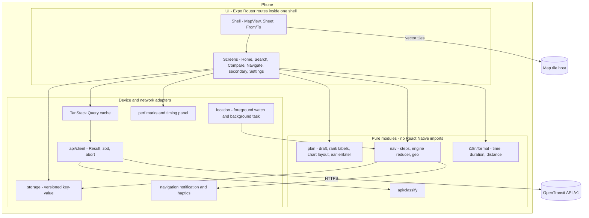
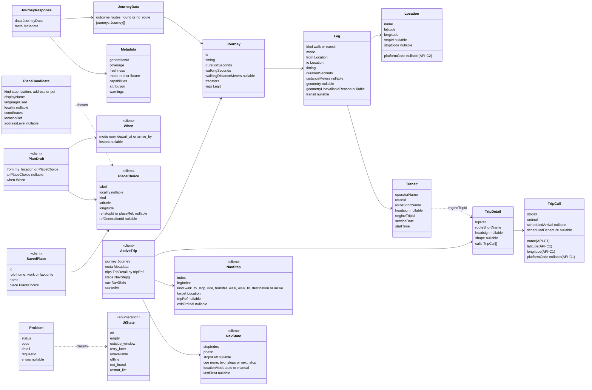
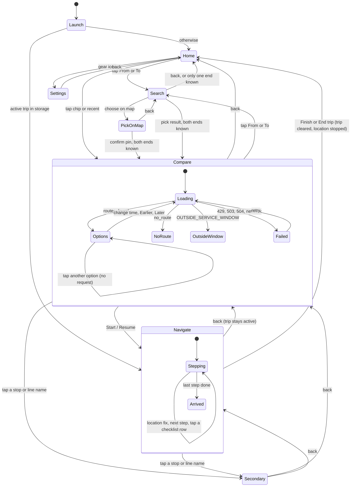
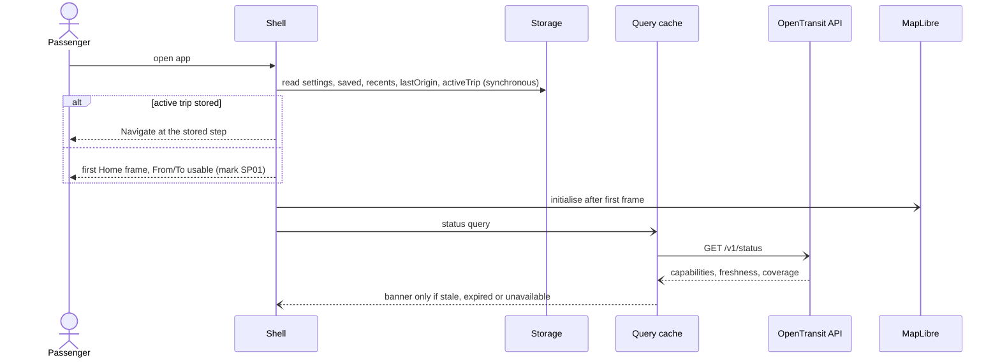
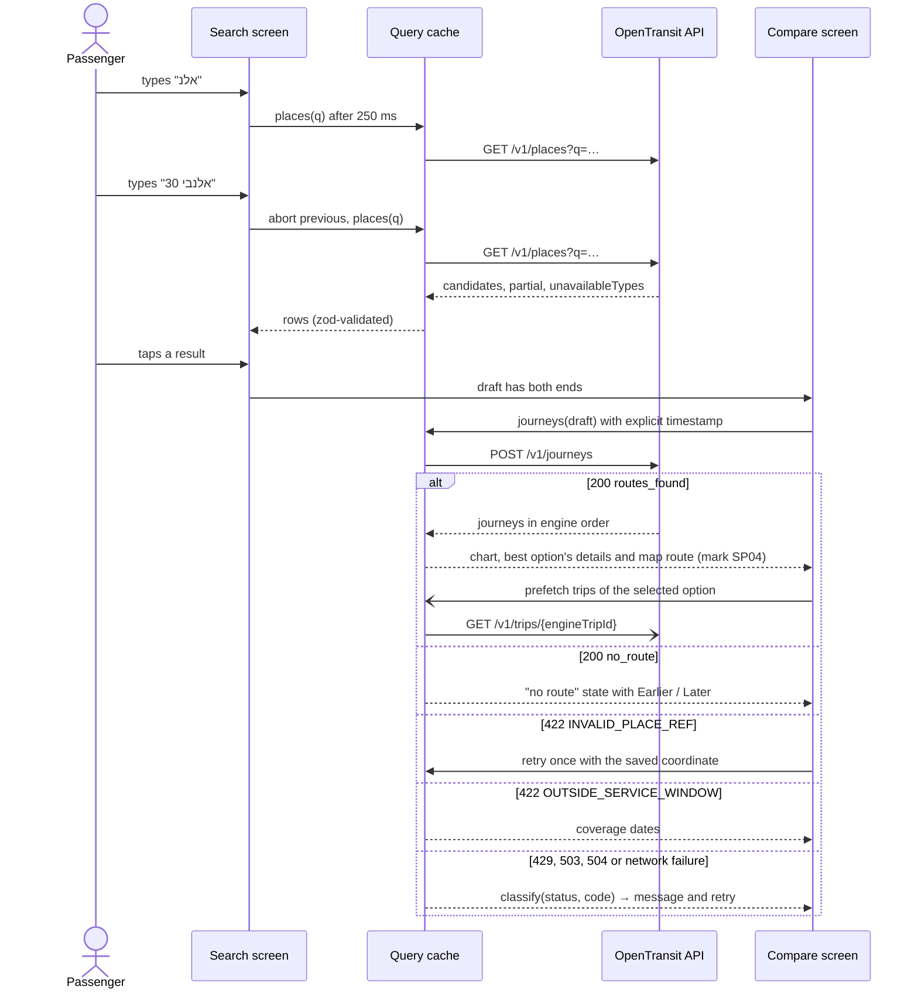
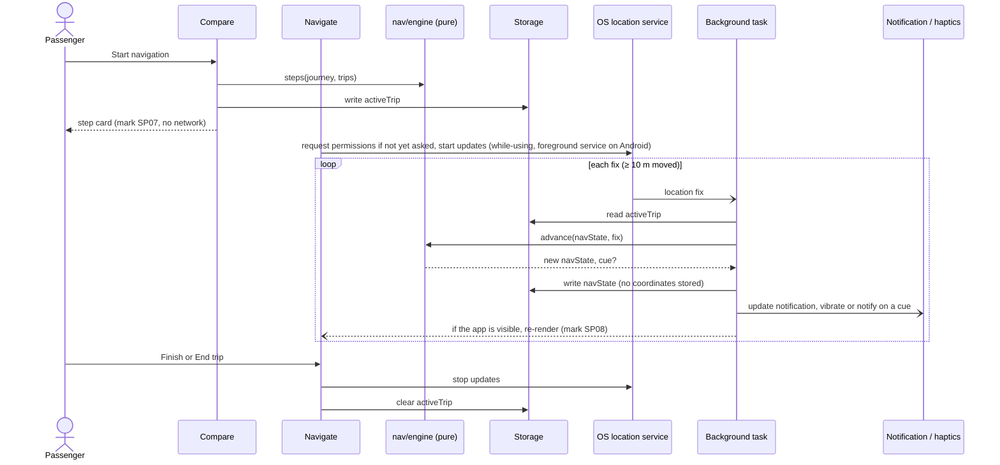
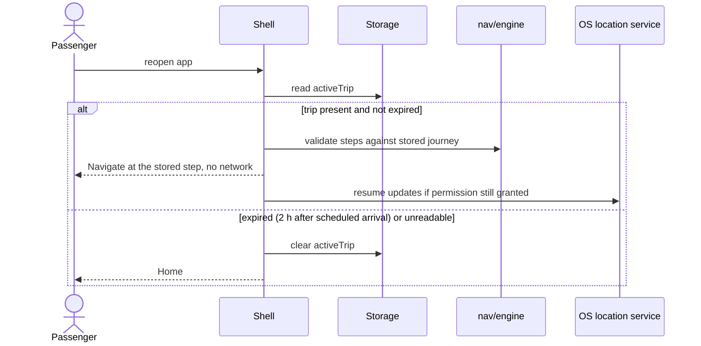
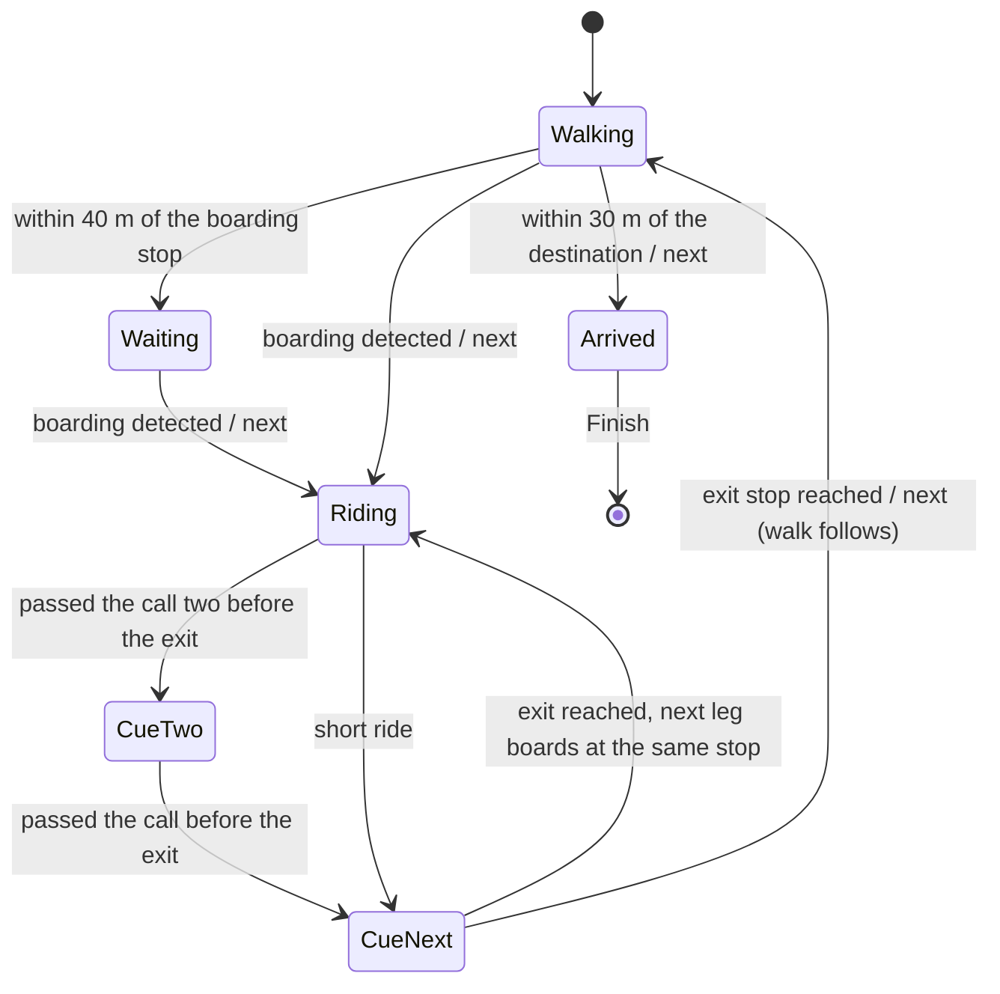

# Phase 2 client design

**Revision, 31 October 2026 (user): web now, native later.** A Vite/React web client is built first in [`apps/web`](../apps/web/README.md) (slices S0–S2 exist; real-API checks pending) to reach a usable preview for the H-1 private deployment. The native Expo / React Native design below remains the later plan, after the API and deployment are stable. Pure modules (API layer, `classify`, i18n, formatting, plan/nav logic) are shared between the two. Phase gates are unchanged.

**Native app: proposal; not implemented.** Interface direction chosen 2 October 2026; native platform chosen 3 October 2026; full design (architecture, UML, screens, navigation engine) written 3 October 2026 and awaiting the user's review. Requirements, stories, speed budgets and acceptance are in the [client PRD](client-prd.md). Tasks, their order and what must be ready before coding are in the [client execution plan](next-steps.md#phase-2-client-execution-plan). Implementation starts under the October 1 [gate revision](../PRD.md): once M2–M4 are accepted locally and the private H-0/H-1 deployment begins. Realtime and alerts remain deferred. The client labels every time as scheduled and shows unavailable live data as unavailable, never as an empty success.

Contents: [interface direction](#interface-direction-user-2-october-2026) · [API constraints and gaps](#constraints-from-the-current-api) · [stack](#stack-and-hosting) · [architecture](#architecture) · [domain model](#domain-model) · [app flow](#app-flow) · [screens](#screens) · [sequences](#sequences) · [navigation engine](#navigation-engine) · [storage](#on-device-storage) · [cross-cutting rules](#cross-cutting-rules) · [copy deck](#core-copy-deck) · [testing](#testing) · [risks and spikes](#risks-and-spikes)

## Interface direction (user, 2 October 2026)

The client is a **Hebrew-first, right-to-left** native app for iPhone and Android (Expo / React Native; user, 3 October) with English mirrored from it. It focuses on two jobs, with no bloat: **planning a trip** (choose where from and where to, compare the options with every fact needed to choose) and **navigating it** (know where you are, and for each step show when the vehicle leaves, where from, which platform, and the next steps). The user compared three designs and chose **Map + timeline**, then picked its **variant B** in the playable prototype: a map with a bottom sheet holds every screen; options are compared as one compact chart on a shared time axis; tapping an option shows its whole route at once; and navigation pins a high-contrast step card at the top of the sheet, near the thumb, above the whole-trip checklist.

Tokens, components (Hebrew previews), the seven-screen flow and the brand book live in the OpenTransit design system, a private claude.ai artifact (`https://claude.ai/artifact/P3US2NygmWPs1iALn555PU`, owner access). Its palette and copy derive from the API playground. It is a static CSS rendition, not implementation evidence. A playable prototype (`https://claude.ai/artifact/FVufx6zTmyzny45pzRpxb5`, private, sample data and a simulated clock) showed three variants: A, full option rows with the step card over the map; B, a compact timeline chart with the step card in the sheet; C, full rows with a large countdown. The user chose B on 2 October, with one change: tapping an option shows its route in detail immediately.

### Surface

- The map is always behind, centred on the person. It draws whatever the sheet is about, and it is never mirrored.
- The sheet has three snap points (peek 35%, half 55%, full 92%). Moving forward replaces its content in place; swiping down or the system back gesture goes back one level and keeps the trip.
- There are no tab bars, menus or overflow buttons. The only floating controls are Back and Locate.

### Language and layout rules

- Every string is written in Hebrew first and addressed with the gender-neutral plural imperative. Units: "דק׳" (min), "מ׳" (m), "ק״מ" (km), "שע׳" (h). Use a 24-hour clock.
- The app forces right-to-left layout in Hebrew and left-to-right in English. Time ranges, leg strips, the comparison axis and progress run right to left in Hebrew; digits, times and line numbers are isolated as left-to-right runs with tabular figures. Directional icons mirror; mode icons do not.
- Trains are named by destination and platform; buses by number and headsign.
- Primary actions sit at the bottom of the sheet. At 360 × 640, after an option is tapped the chart and the start of its route are both visible, and navigation shows the step card and at least the next step without scrolling.

## Constraints from the current API

- `Cache-Control: no-store` on every response; caching is the client's own (TanStack Query). CORS does not apply to a native app.
- Only `POST /v1/journeys` has typed OpenAPI response models. Places, stops, routes, departures, trips and status are untyped, so validate them with schemas checked against recorded fixtures.
- `placeRef` is bound to one generation and returns `422 INVALID_PLACE_REF` after a refresh. Favourites store coordinates and labels; the ref is only a hint.
- Unavailable live data is represented inconsistently: journey `alerts: null`, trip `alerts: "not_enabled"`. Decide capability from `meta.capabilities` and `/v1/status` only.
- `walkingDistanceMeters` and a walk leg's `distanceMeters`/`geometry` can be null: an interior transfer MOTIS cannot street-route keeps its time (`geometryUnavailableReason: street_path_unavailable`, journey warning `TRANSFER_STREET_PATH_UNAVAILABLE`). Render a time-only walk instead of inventing a distance or line.
- The trip link is `leg.transit.engineTripId`, used as `GET /v1/trips/{tripRef}`. Verify encoding against real IDs; an ID containing `/` would not route.
- Journeys come back in the engine's feasible order (`rankingPolicy` in `meta`); the API does not label or rank them. There is no "earlier/later" cursor; the client re-sends a shifted time.
- Journey requests accept a coordinate, a `mot:stop:…` reference or a `placeRef`; "now" must be sent as an explicit timestamp with an offset.

### Contract gaps found on 3 October (read from the code, not from a running API)

The PRD's route details (C04) and navigation (C05) need facts the API does not return today. Checked in `services/api/src/opentransit/api/schemas.py` and `motis_timetable.py`:

| Gap | Today | Needed by | Proposed additive change | Without it |
| --- | --- | --- | --- | --- |
| G1 Trip calls lack names and positions | A call has `stopId`, `callSequence`, `ordinal`, scheduled times and pickup/drop-off types only | S5 stop names in route details; S6 ride progress, "get off in 2 stops", step advance | **API-C1:** add `name`, `latitude`, `longitude`, `platformCode` to each call of `GET /v1/trips/{tripRef}` (the reference store has them) | One `GET /v1/stops/{id}` per intermediate stop (often 10–30 requests per leg), which breaks SP04/SP07 and the "no server request during navigation" rule |
| G2 Journey legs lack the platform | `from`/`to` carry `name`, coordinates, `stopId`, `stopCode`; `platformCode` exists only on departures and stop detail | C04, C05 ("which platform") | **API-C2:** add nullable `platformCode` to a transit leg's `from` and `to` | Platform shown only after the trip detail arrives (if API-C1 lands) or never; trains would read "platform unknown" |
| G3 Departures lack operator and mode | Known follow-up | S7 stop board | **API-C3** (already listed for M7) | Stop board shows line and headsign only |

API-C1 and API-C2 are additive (new nullable fields), need no new data source, and are prerequisites for S5/S6 respectively. Until they exist the client treats the fields as optional and renders "unknown" rather than guessing. This replaces the earlier statement that no API change is needed to serve the client.

## Stack and hosting

**Revised 3 October 2026 (user):** a native app replaces the earlier static web app, which is kept in Git history.

- Expo (React Native, Hermes), TypeScript (strict), TanStack Query, zod, Expo Router. One codebase for iPhone and Android; platform code only for the Android navigation notification and the optional iOS Live Activity.
- MapLibre React Native with visible OSM/MOT attribution, initialised after Home is interactive.
- Bottom sheet and gestures on the UI thread (Reanimated, Gesture Handler).
- Builds: Expo development builds and the Android emulator on Windows; iPhone builds through Expo's cloud build service, which needs the Apple Developer Program (not yet approved). The iOS simulator needs a Mac; Expo Go cannot run the map or background location.
- API base URL per build profile: local (`http://10.0.2.2:8000` from the Android emulator, the PC's LAN address from a phone; cleartext HTTP is allowed in this profile only), preview, production. The H-1 ALB reviewer-IP restriction does not fit phones on 4G; a replacement is an open decision in the PRD.
- Rejected for now: a web version of the client (the playground stays the browser tool); Swift and Kotlin apps (two codebases, and iPhone builds need a Mac); Flutter (a new language).

## Architecture

The app is one shell (map + sheet) whose sheet content is the current route. Logic that decides anything is kept in pure TypeScript modules with no React Native imports, so it runs in Jest without a device and inside the background location task.



### Code organisation

```text
apps/mobile/
  app/                         Expo Router: thin routes (read params, render a screen)
    _layout.tsx                Shell: providers, MapView, Sheet, <Slot/>
    index.tsx                  Home
    search.tsx                 Where from / where to (param: field)
    compare.tsx                Compare + route details
    navigate.tsx               Navigate
    stop/[stopId].tsx  trip/[tripRef].tsx  nearby.tsx  lines.tsx     (S7)
    settings.tsx  timing.tsx   Settings; hidden timing panel
  src/
    api/       client.ts  endpoints.ts  schemas.ts (zod)  generated/ (journey, problem)
               classify.ts  replay.ts  fixtures/
    plan/      draft.ts  journeyQuery.ts  rank.ts  chartLayout.ts  shift.ts
    nav/       steps.ts  engine.ts  geo.ts  task.ts  cues.ts  constants.ts
    map/       MapView.tsx  layers.ts  camera.ts
    shell/     Sheet.tsx  FromTo.tsx  Banner.tsx  states.tsx (skeleton, empty, error)
    storage/   store.ts  migrations.ts
    i18n/      he.ts  en.ts  t.ts  format.ts
    theme/     tokens.ts
    perf/      marks.ts
  modules/nav-notification/    Android navigation notification (Kotlin); iOS Live Activity later
  e2e/                         Maestro flows
```

Dependency direction: `app/` → `src/<feature>` → `api`, `storage`, `i18n`, `theme`. `plan/`, `nav/steps`, `nav/engine`, `nav/geo`, `api/classify` and `i18n/format` import nothing from React Native or Expo. Screens never call `fetch`; they use query hooks. Nothing outside `api/` knows a URL.

### Where state lives (SE04)

| State | Home | Lifetime |
| --- | --- | --- |
| Server data: status, places, journeys, trips, stops, departures | TanStack Query cache, keyed by request | Memory; journeys and trips of the active trip are also copied into storage |
| Settings, saved places, recents, last origin, active trip | Versioned on-device storage ([schema](#on-device-storage)) | Until cleared |
| Transient screen state: the plan draft (from, to, when), selected option, sheet snap, text being typed | React state in the shell and route params | The session; not a third store, never persisted |

## Domain model

API types are what `/v1` returns (generated for journeys and problems, zod-validated for the rest). Client types exist only for what the phone itself owns.



Rules that keep the client free of transport logic (SE02):

- **Order is the API's.** Options are drawn in the order returned. The client never drops, merges or re-sorts journeys.
- **Rank labels are captions over returned numbers**, computed by one pure function (`plan/rank.ts`): the first journey is "מומלץ" (recommended, the engine's first choice); among the others, a strictly shortest `durationSeconds` gets "הכי מהיר" (fastest), `transfers == 0` gets "בלי החלפות" (no transfers) or a strictly lowest count gets "פחות החלפות" (fewer transfers), and a strictly lowest `walkingSeconds` gets "פחות הליכה" (less walking). One label per option at most; ties get none.
- **Earlier / Later re-send a shifted request** (`plan/shift.ts`): Later sends `departAt` = the latest shown departure + 1 minute; Earlier sends `arriveBy` = the earliest shown arrival − 1 minute. The new answer replaces the chart.
- **Journey input** (`plan/journeyQuery.ts`): a stop is sent as `{kind: stop}`; my location and map pins as coordinates; a searched place as its `placeRef` when it came from the current generation, otherwise as its saved coordinate. `INVALID_PLACE_REF` retries once with the coordinate. S1 checks whether a `placeRef` and its returned coordinate route identically; if so the client sends coordinates always and the retry is deleted.

## App flow



- Back never asks for confirmation (no modals, SI04). Leaving Navigate with Back keeps the trip active: Compare's pinned button then reads "חזרה לניווט" (resume) and Home shows one "active trip" row at the top of the sheet. A trip ends only at Finish, at "סיום הנסיעה" (End trip), when another trip is started, or two hours after its scheduled arrival.
- Permission prompts happen only on a tap that needs them: location at the first use of "my location" or at Start; notifications at the first Start (they carry the locked-phone cue and the Android navigation notification). Denying either leaves the app fully usable with manual steps.

## Screens

Wireframes show the Hebrew (right-to-left) arrangement with English placeholder text; English mirrors it. Exact tokens and component styling come from the design system artifact and are copied into `theme/tokens.ts` in S0.

### 1. Home — C01

```text
┌──────────────────────────────────┐
│ ┌──────────────────────────────┐ │
│ │ ⇅   My location            ● │ │  From/To card (floating)
│ │     Where to?              ◎ │ │
│ └──────────────────────────────┘ │
│  [stale-data banner, only if so] │
│              (map)               │
│ (◎)                              │  Locate
│┌────────────────────────────────┐│
││              ▬▬                ││  sheet at half
││   [+]  [Mum]  [Work]  [Home]   ││  chips, Home first (right)
││ ────────────────────────────── ││
││ 🕘  Technion, Haifa            ││  recents (≤ 10)
││ 🕘  Allenby 30, Tel Aviv       ││
││ ⚙                              ││  Settings (only non-core control)
│└────────────────────────────────┘│
└──────────────────────────────────┘
```

| Aspect | Design |
| --- | --- |
| Data | Storage only (saved, recents, last origin), read synchronously before the first frame. `GET /v1/status` runs after the first frame, cached 5 minutes. |
| Primary action | Tap the To field. |
| Events | Chip or recent → set To → Compare. From/To → Search. ⇅ swaps. Empty Home/Work chip → Search in "save as Home/Work" mode. `+` → Search in "save favourite" mode. |
| States | First launch: chips show "set Home", "set Work"; no recents; From reads "המיקום שלי" (permission asked only when it is used). Status stale/expired or a capability unavailable → one banner. Offline → Home still renders; the banner reads "אין חיבור". Active trip → a resume row above the chips. |
| Stories | CU01, CU07, CU16, CU20 |

### 2. Where to / Where from — C02

```text
┌──────────────────────────────────┐
│ (→)  [ alenb|                 ✕ ]│  text field, focused, keyboard open
│ ────────────────────────────────│
│ 📍  Choose on map                │  always first row
│ ◎   My location                  │  (From field only)
│ ────────────────────────────────│
│ 🏠  Allenby 30 · Tel Aviv        │  address · "street-level" tag when so
│ 🚏  Allenby/Yehuda Halevi · stop │
│ 🚉  HaHagana · station           │
│ ⭐  The Carmel Market · place    │
│ ────────────────────────────────│
│ ⚠ Addresses unavailable right now│  partial category, inline
└──────────────────────────────────┘
```

| Aspect | Design |
| --- | --- |
| Data | `GET /v1/places?q&lang&limit=10` (+ `near` only when location is already granted). Debounce 250 ms, from 2 characters, previous request aborted. Before typing: saved places and recents. |
| Primary action | Tap a result. |
| Events | Result → fills the field; if both ends are known → Compare, else back to Home. "Choose on map" → the sheet drops to peek, a centre pin appears, the confirm button reads "בחירת המיקום הזה". |
| States | Typing (skeleton rows, no layout shift) · results · zero matches ("לא נמצאו תוצאות", a real empty success) · `partial` (inline row per unavailable type) · all unavailable (503 → error row with retry) · offline. A label in another language keeps its original text. |
| Stories | CU02, CU09, CU10, CU11 |

### 3. Compare and 4. Route details — C03, C04

One screen: the chart, then the selected option's details, then Earlier/Later, with Start pinned.

```text
┌──────────────────────────────────┐
│ (→) Technion  ←  My location   ⇅ │  From/To, compact
│   [Arrive by] [Depart at] [Now•] │  time control, inline
│              (map: route of ①)   │
│┌────────────────────────────────┐│
││ 09:20      09:00      08:40    ││  shared axis, earliest on the right
││ ①  ░░████910████░░   47 min   ││  recommended (selected)
││ ②   ░███16██░███train██░ 52   ││  no transfers / fastest / …
││ ③     ░░██████82██████░░ 58   ││
││ Times are scheduled             ││
││ ────────────────────────────── ││
││ 08:41 → 09:28 · 47 min         ││  details of ①
││ 1 transfer · 6 min walk        ││
││ 🚶 4 min · 300 m to Dizengoff  ││
││ 🚌 910 → Haifa · Egged · 08:47 ││
││    platform 3 · 12 stops       ││
││    get off: Hof HaCarmel       ││
││ ⏱ 6 min transfer               ││
││ 🚆 to Haifa Center · plat. 2   ││
││ [Earlier]            [Later]   ││
││ ┌────────────────────────────┐ ││
││ │      Start navigation      │ ││  pinned
││ └────────────────────────────┘ ││
│└────────────────────────────────┘│
└──────────────────────────────────┘
```

| Aspect | Design |
| --- | --- |
| Data | `POST /v1/journeys` the moment both ends are known, `results: 3`, explicit timestamp. After the chart paints, `GET /v1/trips/{engineTripId}` for the selected option's transit legs in the background (stop counts, names, platforms); other options' trips load when tapped. |
| Chart | `plan/chartLayout.ts` maps each journey to a bar on an axis from the earliest departure to the latest arrival. Walk segments are hatched, transit segments solid with the line number (or a train icon). Duration and rank label sit beside each bar. Space for three rows is reserved while loading. |
| Primary action | Start navigation (or Resume when this journey is the active trip). |
| Events | Tap an option → select, redraw the map, swap the details (no request, SP06). Time control → inline picker; changing it re-requests. Earlier/Later → shifted request. Stop or line name → secondary screen (S7). |
| Details per step | Walk: minutes and metres, or minutes only when distance is null ("הליכה כ־4 דק׳"). Transit: line or train destination, operator, departure time, platform when known, stop count, exit stop. Between transit legs: transfer wait. |
| States | Loading (skeleton chart) · options · `no_route` ("לא נמצא מסלול", with Earlier/Later and "change time") · `OUTSIDE_SERVICE_WINDOW` (shows coverage dates) · unavailable/timeout/rate-limited (message + retry, honouring `Retry-After`) · offline · walk-only option (labelled "הליכה בלבד") · fewer than three options (rows collapse) · trip detail failed (details show without stop count; never blocks Start). |
| Stories | CU01–CU04, CU06, CU07, CU12–CU14, CU19 |

### 5. Navigate — C05

```text
 Walk to the stop                     On board, cue active
┌──────────────────────────────────┐ ┌──────────────────────────────────┐
│          (map: you + leg)        │ │          (map: you + leg)        │
│┌────────────────────────────────┐│ │┌────────────────────────────────┐│
││ ╔════════════════════════════╗ ││ ││ ╔════════════════════════════╗ ││
││ ║ Walk to Dizengoff Center   ║ ││ ││ ║ GET OFF AT THE NEXT STOP   ║ ││ cue colour
││ ║ 180 m · bus 910 in 5 min   ║ ││ ││ ║ Hof HaCarmel · 09:21       ║ ││
││ ║ 08:47 · platform 3         ║ ││ ││ ║ then: train · platform 2   ║ ││
││ ╚════════════════════════════╝ ││ ││ ╚════════════════════════════╝ ││
││ ✓ Leave 08:41                  ││ ││ ✓ Walk to Dizengoff Center     ││
││ ● Walk 4 min                   ││ ││ ● 910 → Haifa · 1 stop left    ││
││ ○ 910 → Haifa · 12 stops       ││ ││ ○ Transfer 6 min               ││
││ ○ Transfer 6 min               ││ ││ ○ Train to Haifa Center        ││
││ ○ Arrive 09:28                 ││ ││ ○ Arrive 09:28                 ││
││ End trip                       ││ ││ End trip                       ││
││ ┌────────────────────────────┐ ││ ││ ┌────────────────────────────┐ ││
││ │         Next step          │ ││ ││ │         Next step          │ ││
││ └────────────────────────────┘ ││ ││ └────────────────────────────┘ ││
│└────────────────────────────────┘│ │└────────────────────────────────┘│
└──────────────────────────────────┘ └──────────────────────────────────┘
```

| Step kind | Step card | Advances when |
| --- | --- | --- |
| Walk to a stop | Instruction, distance left, countdown to the vehicle; line, departure time, platform | Boarding detected, or manually |
| Ride | Line and stops left; exit stop and its scheduled time; what comes next | Exit stop reached, or manually |
| Transfer walk | Walk to the platform; countdown to the next vehicle; destination, platform, departure. Time only when the street path is unavailable | Boarding detected, or manually |
| Walk to the destination | Instruction and distance left | Destination reached, or manually |
| Arrive | Arrival time and "סיום" (Finish) | Finish |

| Aspect | Design |
| --- | --- |
| Data | The cached journey and trips only. A trip not yet fetched is requested once; nothing else goes to the server. |
| Primary action | "השלב הבא" (next step); on the last step, "סיום". |
| Events | Location fix → engine → card and checklist update. Tapping a checklist row makes it the current step (corrects a wrong advance in either direction). "סיום הנסיעה" ends the trip and stops location. Back keeps the trip and returns to Compare. |
| States | Location granted (auto) · location denied or lost (one banner: "השלבים מתקדמים ידנית") · no fix for 60 s ("אין מיקום כרגע") · cue two-stops · cue next-stop · trip detail missing for a ride (stops left hidden, exit stop and time still shown) · arrived · restored after the app was killed. |
| Outside the app | Android: the navigation notification mirrors the step card and vibrates on cues. iPhone: the background location indicator; the cue arrives as a local notification; Live Activity later. |
| Stories | CU05, CU06, CU08, CU15, CU17, CU18 |

The earlier design's "margin and next departure" on the walk card is reduced to the countdown: listing the following departure would need a departures request during navigation. It can return once a prefetch at Start is measured within budget.

### 6. Secondary screens — C06 (S7)

Opened from a stop or line name; each replaces the sheet content and returns with Back.

| Screen | API | States |
| --- | --- | --- |
| Stop | `GET /v1/stops/{id}`; `GET /v1/stops/{id}/departures` (infinite list, cursor) | Empty board (valid success) · `INVALID_CURSOR` → restart list · 404 "כבר לא בלוח הזמנים" · unavailable |
| Trip | `GET /v1/trips/{tripRef}` | Calls with times, restrictions, shape on the map · 404 · unavailable |
| Nearby | `GET /v1/stops?near=…` or `bbox` (zoom 14 or closer, at most 100 km²) | No stops here · zoom in to see stops · unavailable |
| Lines | `GET /v1/routes?…`, `GET /v1/routes/{id}`, its patterns | Several operators share a number (shown separately) · empty · unavailable |

### 7. Settings — C07

A plain list: language (עברית / English / system), Home, Work, favourites (rename, delete), "מחיקת כל הנתונים במכשיר" (clear all local data; this one destructive action confirms inline with a second tap, not a modal), data status (generation date, coverage, freshness, capabilities), attribution (Ministry of Transport, © OpenStreetMap contributors, tile host), licences, version. A long press on the version opens the hidden timing panel.

## Sequences

### Cold start (SP01)



### Search, then compare (SP04, SP05)



### Start navigation and advance with the phone locked (SP07, SP08)



### Restore after the app is killed (CU08)



## Navigation engine

`nav/engine.ts` is a pure reducer: `advance(state, event) → { state, effects }`, where an event is a location fix, a clock tick, "next", or "jump to step n", and effects are cue requests. It holds no timers and performs no I/O, so the foreground screen, the background task and Jest all run the same code.

**Steps** (`nav/steps.ts`) map one-to-one from the journey's legs: a walk before a transit leg is `walk_to_stop`; a transit leg is `ride`; a walk between transit legs is `transfer_walk`; a final walk is `walk_to_destination`; then `arrive`. A ride step gets its exit call by matching the leg's `to.stopId` and scheduled arrival in the trip's calls.



Initial thresholds, kept in `nav/constants.ts` and tuned in S6 against simulated and real rides:

| Rule | Initial value |
| --- | --- |
| Ignore a fix | Reported accuracy worse than 100 m, or older than 10 s |
| At the boarding stop | Within 40 m of the leg's `to` |
| Boarding detected | After reaching the stop (or within 60 m of it), from 1 minute before the scheduled departure: the fix is more than 120 m from the stop and within 80 m of the ride leg's geometry |
| Ride progress | The fix is projected onto the leg geometry; a call is "passed" when the projection is beyond that call's own projection. Progress never moves backwards on its own |
| Cues | "רדו בעוד 2 תחנות" on passing the call two before the exit; "רדו בתחנה הבאה" on passing the call before it |
| Exit reached | Within 50 m of the exit stop |
| Destination reached | Within 30 m of the final `to` |
| Location lost | No accepted fix for 60 s → hint; nothing advances on the clock alone |

- **Truthful:** the engine never advances from the schedule. Without fixes (tunnel, train, permission denied) the card keeps showing scheduled times and waits for a fix or a tap.
- **Needs API-C1:** ride progress and cues need each call's coordinates. Without them a ride step shows only the exit stop and its scheduled time and advances manually or on reaching the exit stop.
- **Background:** one Expo task-manager task receives fixes while the phone is locked, using "while using" permission (iOS background location indicator; Android foreground service with the navigation notification). The task reads the active trip, calls `advance`, writes the new nav state and updates the notification. Updates stop at Finish, End trip or trip expiry.
- **Cues outside the app:** Android vibrates through the navigation notification; iPhone posts a local notification, because haptics cannot fire while the app is not in front. Both need the notification permission asked at the first Start; without it the cue is visible only in the app. Local notifications are created on the phone; there is no push service.
- **Privacy:** fixes are used in memory and discarded. The stored nav state holds the step index, phase and stops left, never a position.

## On-device storage

Versioned keys in one key-value store with a synchronous read (proposed: `expo-sqlite/kv-store`; the keychain-backed secure store limits value size and on iPhone survives uninstall, which would break "clear by uninstalling"). S0 measures the synchronous read against SP01.

| Key | Value | Notes |
| --- | --- | --- |
| `ot.v` | `1` | Schema version; `migrations.ts` upgrades in order, unknown future versions reset to empty |
| `ot.settings` | `{ lang: he \| en \| system }` | |
| `ot.saved` | `SavedPlace[]` | Home, Work, favourites; coordinates and label are the truth, `ref` is a hint |
| `ot.recents` | `PlaceChoice[]` | At most 10, newest first, deduplicated by coordinates; never "my location" |
| `ot.lastOrigin` | `PlaceChoice \| null` | A chosen place only, never a device position |
| `ot.activeTrip` | `ActiveTrip \| null` | Journey, its trips, steps, nav state. If the trip started from "my location" its first leg holds that start point until the trip ends; it is deleted at Finish, End trip or expiry |

"Clear all local data" deletes every key and the query cache. Every value is zod-validated on read; an unreadable value is dropped, not repaired.

## Cross-cutting rules

- **API layer:** hand-written `Result<T>` client (`{ok: true, data, meta}` or `{ok: false, problem}`), with abort, a 10 s timeout and `lang`. Journey and problem types are generated from a committed OpenAPI snapshot; other responses are validated with zod. A pure `classify(status, code)` maps problems to UI states.
- **States:** no route, no departures and no matches are successes with empty results. Partial or unavailable search categories are shown inline. Capabilities that are `not_enabled` read "זמני אמת והתראות אינם זמינים". Show a stale-data banner, and a "test data" banner in fixture mode.
- **`classify(status, code)`:**

  | Input | UI state | What the passenger sees |
  | --- | --- | --- |
  | 422 `OUTSIDE_SERVICE_WINDOW` | `outside_window` | The coverage dates and "choose another time" |
  | 422 `INVALID_PLACE_REF` | (retry once with the coordinate) | Nothing, unless the retry fails |
  | 422 `INVALID_CURSOR` | `restart_list` | The list restarts from the top |
  | 404 | `not_found` | "כבר לא בלוח הזמנים" |
  | 429 | `retry_later` | Retry after `Retry-After` |
  | 503 `FEED_EXPIRED`, `DATA_UNAVAILABLE`, `SERVER_OVERLOADED`, `NOT_READY`; 504 `ENGINE_TIMEOUT` | `unavailable` | "השירות אינו זמין זמנית" with retry |
  | Network failure, timeout, invalid payload | `offline` | "אין חיבור ל־OpenTransit" with retry |
  | Any other 4xx | `unavailable` | Generic message; the request ID is shown in the timing panel only |

- **Time:** always Asia/Jerusalem with an explicit offset and a "מתוכנן" (scheduled) label. Port the playground's DST handling (`time.mjs`) and its tests; they must pass with the host clock in UTC.
- **i18n/RTL:** typed Hebrew and English dictionaries with key parity, Intl formatters, logical (start/end) layout only, left-to-right isolation for line numbers, times and mixed-language names.
- **Accessibility:** VoiceOver and TalkBack labels on every control, system text size without clipping on core screens, announcements when the step or cue changes, 44 pt targets, nothing conveyed by colour alone, every map fact also present as text. The chart is read as a list ("אפשרות 1, מומלץ, 47 דקות, יציאה 08:41, החלפה אחת").
- **Privacy:** no analytics, tracking or crash-reporting SDKs and no third-party fonts. Location only after a tap, never stored beyond the active trip's own start point; background location only during an active navigation.
- **Performance budget:** see the [client PRD](client-prd.md#4-speed-requirements) (SP01–SP12). Marks are recorded by `perf/marks.ts` and shown in the timing panel.

## Core copy deck

Hebrew is the source; the user reviews it before S4 (task S2.1). Keys are illustrative.

| Key | עברית | English |
| --- | --- | --- |
| `from.placeholder` / `to.placeholder` | מאיפה? / לאן? | Where from? / Where to? |
| `place.myLocation` | המיקום שלי | My location |
| `place.home` / `place.work` | בית / עבודה | Home / Work |
| `search.pickOnMap` | בחירה במפה | Choose on map |
| `search.empty` | לא נמצאו תוצאות | No results |
| `when.now` / `when.depart` / `when.arrive` | עכשיו / יציאה ב־ / הגעה עד | Now / Depart at / Arrive by |
| `rank.recommended` / `rank.fastest` | מומלץ / הכי מהיר | Recommended / Fastest |
| `rank.noTransfers` / `rank.lessWalking` | בלי החלפות / פחות הליכה | No transfers / Less walking |
| `compare.scheduled` | הזמנים מתוכננים, לא בזמן אמת | Times are scheduled, not live |
| `compare.earlier` / `compare.later` | מוקדם יותר / מאוחר יותר | Earlier / Later |
| `compare.noRoute` | לא נמצא מסלול | No route found |
| `compare.start` / `compare.resume` | התחלת ניווט / חזרה לניווט | Start navigation / Resume navigation |
| `nav.next` / `nav.finish` / `nav.end` | השלב הבא / סיום / סיום הנסיעה | Next step / Finish / End trip |
| `nav.cueTwo` / `nav.cueNext` | רדו בעוד 2 תחנות / רדו בתחנה הבאה | Get off in 2 stops / Get off at the next stop |
| `nav.manual` | השלבים מתקדמים ידנית | Steps advance manually |
| `leg.platform` / `leg.stops` | רציף / תחנות | Platform / stops |
| `state.liveUnavailable` | זמני אמת והתראות אינם זמינים | Live times and alerts unavailable |
| `state.unavailable` / `state.offline` | השירות אינו זמין זמנית / אין חיבור ל־OpenTransit | Temporarily unavailable / Can't reach OpenTransit |
| `state.retry` | נסו שוב | Try again |
| `state.notFound` | כבר לא בלוח הזמנים | No longer in the timetable |

## Testing

| Layer | Tool | What it proves |
| --- | --- | --- |
| Pure modules | Jest, no device | `classify` table, rank labels, chart layout, earlier/later, DST and formatting, steps derivation, engine against recorded GPS traces and synthetic routes, storage migrations |
| Components | Jest + React Native Testing Library, fixtures replayed | Every state in the screen tables, in Hebrew and English, with accessibility labels |
| End to end | Maestro on the Android emulator, fixture replay | Tap counts (SI01, SI02), back behaviour (SI06), no launch prompt (SI03), 360 × 640 screenshots (SI07), simulated route with the screen locked |
| Real | `@real` flows against the local API, skipped unless `/readyz` is 200 | Dizengoff Center → Technion plans and replays through navigation |
| Timing | Marks in the timing panel, release builds on the reference phones | SP01–SP09 records per slice from S4 |
| Human | HC review ([PRD §9](client-prd.md#9-acceptance-and-release)) | Usable on real trips; structural checks never substitute |

Fixtures are recorded from the local API by a script, sanitised (no request IDs that identify a session, no personal coordinates: corpus journeys only) and labelled as fixture data in the app.

## Risks and spikes

Each spike is a bounded throwaway check whose result is recorded in the task's PR; two failed attempts escalate to the user.

| ID | Unverified assumption | Check | Fallback |
| --- | --- | --- | --- |
| SPK-1 | The current Expo SDK, MapLibre React Native, Reanimated and forced RTL work together in a development build on the Android emulator from Windows | Part of S0: map behind a draggable sheet, Hebrew text, 60 fps drag | Pin older compatible versions; replace the sheet library with a hand-written Reanimated sheet |
| SPK-2 | Location updates continue with the phone locked using only "while using" permission (Android foreground service; iOS background mode with the indicator), and a cue can vibrate or notify while locked | Before S6: a 20-line task logging fixes on a locked emulator and a real Android phone; iPhone once the Apple account exists | A small native module for the service; if iOS requires "always", the PRD's SI03 goes back to the user |
| SPK-3 | Hermes formats Asia/Jerusalem times and Hebrew correctly on both platforms, including the 25 October DST change | Part of S2: the ported `time.mjs` tests on device | Format with a small hand-written Asia/Jerusalem offset table |
| SPK-4 | A synchronous storage read plus first frame fits SP01 on a mid-range Android | Part of S0 with the timing panel | Read only `ot.activeTrip` and `ot.saved` before the first frame |
| R1 | API-C1/API-C2 slip | — | S5 ships details without intermediate stop names; S6 ships manual-plus-exit-stop advance; cues wait |
| R2 | GPS on trains and in tunnels is poor | S6 real-ride traces | Manual advance is always present; no clock-based advance |
| R3 | The preview is not reachable from a phone on 4G | PRD §10 decision 3 | Field timings wait; development continues against the local API over LAN |
| R4 | Tile host availability or terms | Licence audit entry before S8 | Self-hosted Protomaps extract earlier than planned |

## API follow-ups

Blocking for the client: API-C1 (before S5 details are complete and before S6 ride progress), API-C2 (before platform claims in C04/C05). Non-blocking (M7): response models for the non-journey endpoints, one value for unavailable alerts, operator and mode on departure items (API-C3). Details in the [execution plan](next-steps.md#phase-2-client-execution-plan).

## Defaults pending user confirmation

- Name "OpenTransit", with the teal palette from the playground as set out in the design system.
- System fonts (no third-party fonts), drawn line icons with the option of switching to a licensed open set.
- OpenFreeMap vector tiles for the preview, moving to a self-hosted Protomaps Israel extract before public release. The tile host sees user IPs and viewports.
- Native app first (decided 3 October); the iOS Live Activity may follow the first preview.
- New on 3 October, listed in the [PRD's open decisions](client-prd.md#10-open-decisions-for-the-user): the API additions, local notifications for the locked-phone cue, the storage module, light and dark appearance, and the app identifiers.
