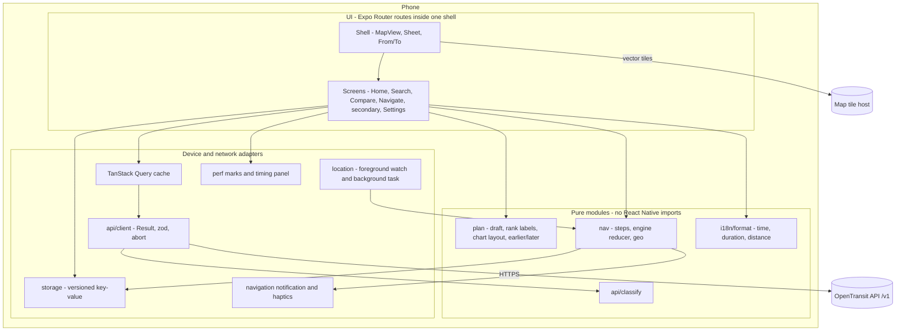
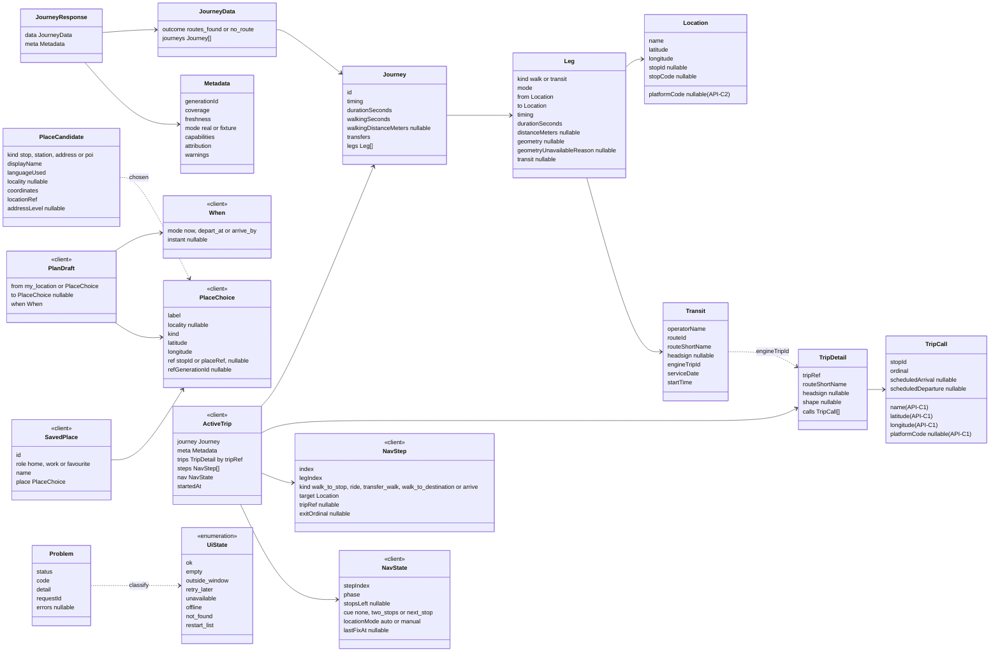
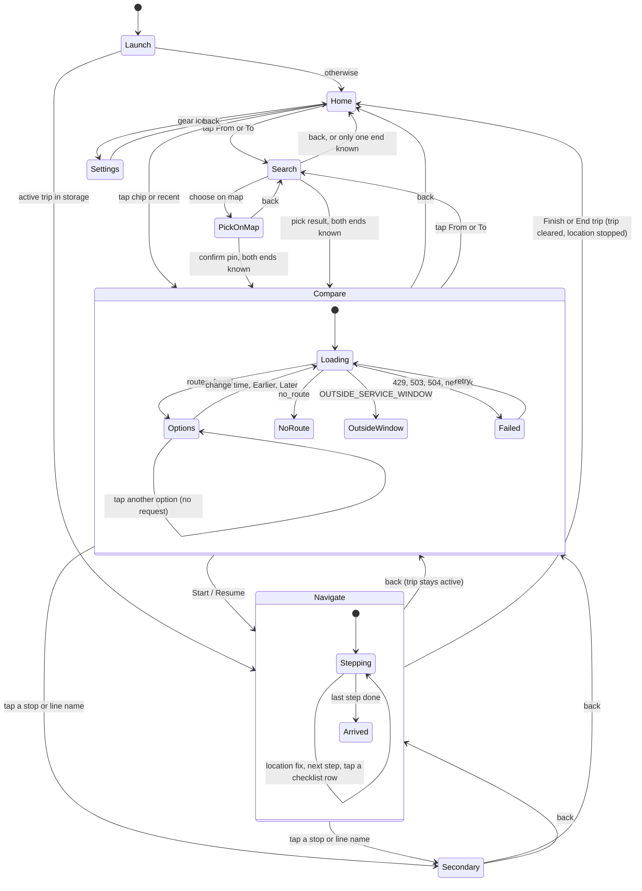
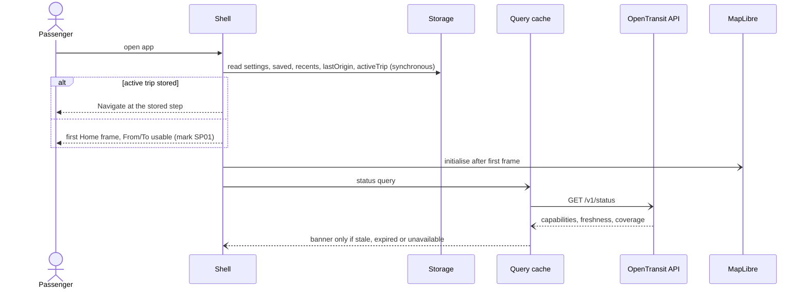
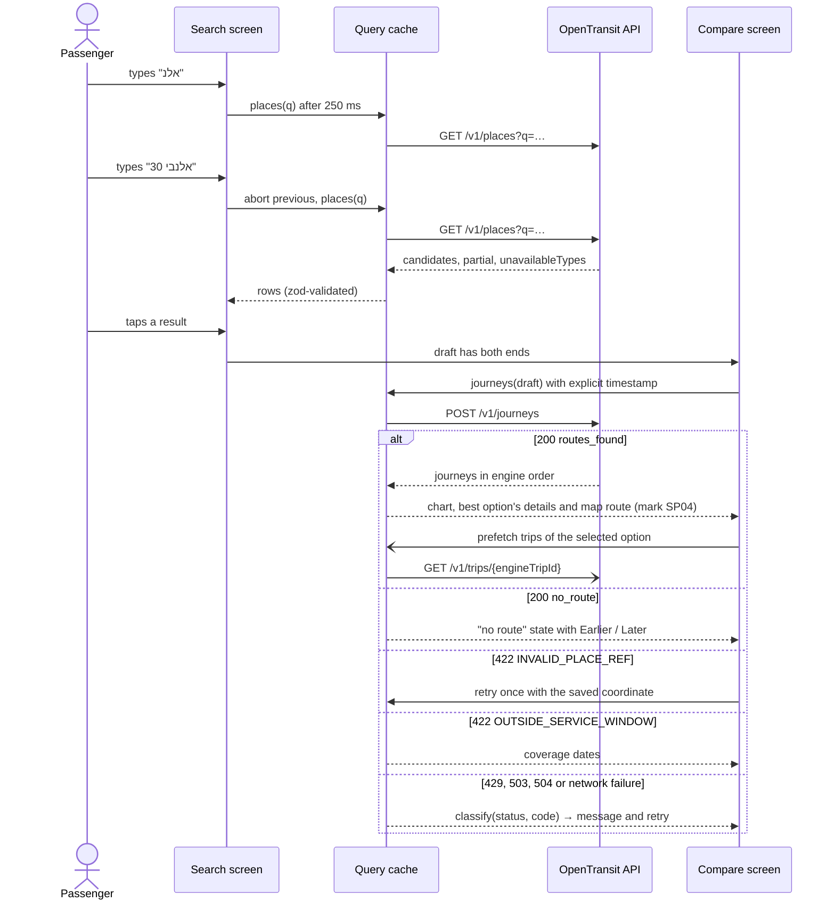
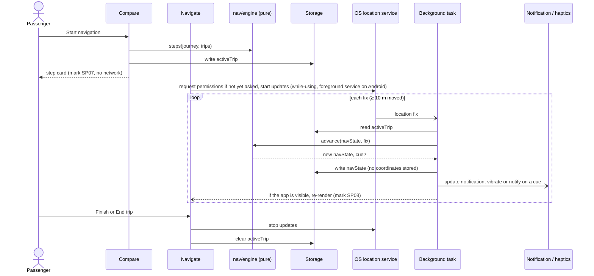
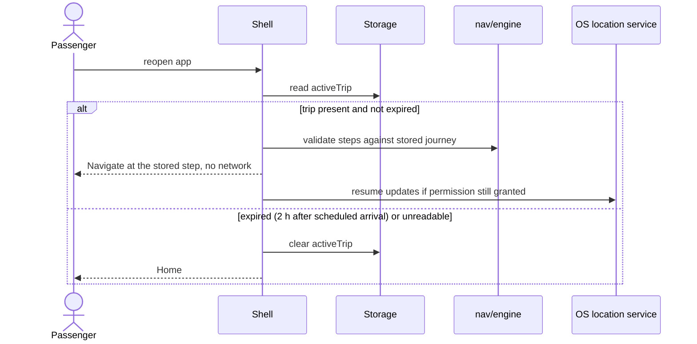
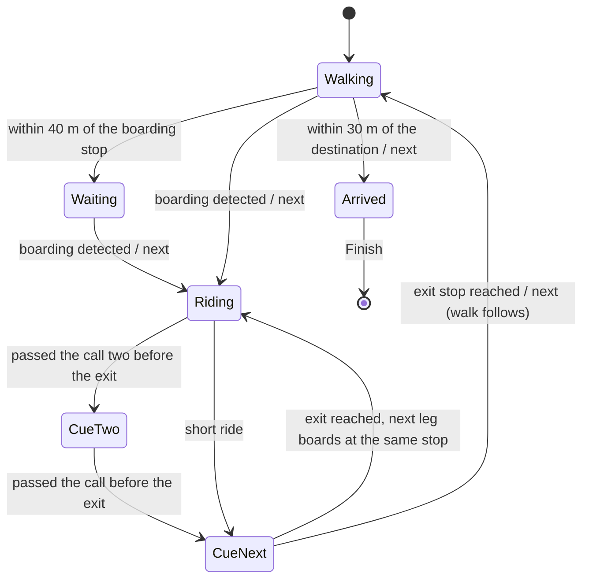

# Phase 2 client design

**Revision, 31 October 2026 (user): web client for testing/preview; native app is the product.** The native Expo / React Native app designed below remains the product client, for the speed and smoothness only an installed app gives; it follows once the API and deployment are stable. A Vite/React web client in [`apps/web`](../apps/web/README.md) (slices S0–S2 exist; real-API checks pending) is a testing and preview tool for the H-1 private deployment only: enough to exercise the API end to end in a phone browser and gather feedback, not a product release and not polished beyond what testing needs. The user widened that scope twice: a UX polish pass with human-like testing (31 October) and the design system's components and tokens with a dark default (6 November). Pure modules (API layer, `classify`, i18n, formatting, plan/nav logic) are built to be shared with the native app. Phase gates are unchanged.

**Native app: proposal; not implemented.** Interface direction chosen 2 October 2026; native platform chosen 3 October 2026; visual direction chosen 11 November 2026 and applied to the web test client the same day (not yet to the design system artifact); full design (architecture, UML, screens, navigation engine) written 3 October 2026 and awaiting the user's review. Requirements, stories, speed budgets and acceptance are in the [client PRD](client-prd.md). Tasks, their order and what must be ready before coding are in the [client execution plan](next-steps.md#phase-2-client-execution-plan). Implementation starts under the October 1 [gate revision](../PRD.md): once M2–M4 are accepted locally and the private H-0/H-1 deployment begins. Realtime and alerts remain deferred. The client labels every time as scheduled and shows unavailable live data as unavailable, never as an empty success.

Contents: [interface direction](#interface-direction-user-2-october-2026) · [visual direction](#visual-direction-user-11-november-2026) · [API constraints and gaps](#constraints-from-the-current-api) · [stack](#stack-and-hosting) · [architecture](#architecture) · [domain model](#domain-model) · [app flow](#app-flow) · [screens](#screens) · [sequences](#sequences) · [navigation engine](#navigation-engine) · [storage](#on-device-storage) · [cross-cutting rules](#cross-cutting-rules) · [copy deck](#core-copy-deck) · [testing](#testing) · [risks and spikes](#risks-and-spikes)

## Interface direction (user, 2 October 2026)

The client is a **Hebrew-first, right-to-left** native app for iPhone and Android (Expo / React Native; user, 3 October) with English mirrored from it. It focuses on two jobs, with no bloat: **planning a trip** (choose where from and where to, compare the options with every fact needed to choose) and **navigating it** (know where you are, and for each step show when the vehicle leaves, where from, which platform, and the next steps). The user compared three designs and chose **Map + timeline**, then picked its **variant B** in the playable prototype: a map with a bottom sheet holds every screen; options are compared as one compact chart on a shared time axis; tapping an option shows its whole route at once; and navigation pins a high-contrast step card at the top of the sheet, near the thumb, above the whole-trip checklist.

Tokens, components (Hebrew previews), the seven-screen flow and the brand book live in the OpenTransit design system, a private claude.ai artifact (`https://claude.ai/artifact/P3US2NygmWPs1iALn555PU`, owner access). Its palette and copy derive from the API playground. It is a static CSS rendition, not implementation evidence. The web client keeps a checked-in copy of its `tokens.json` and component CSS (`bundle.css`) in `apps/web/src/styles/design-system/` and generates its tokens from them (`npm run tokens`, with a test that fails on drift), so the two cannot diverge; the artifact URL, version and `meta.synced` date are recorded in the generated files. A playable prototype (`https://claude.ai/artifact/FVufx6zTmyzny45pzRpxb5`, private, sample data and a simulated clock) showed three variants: A, full option rows with the step card over the map; B, a compact timeline chart with the step card in the sheet; C, full rows with a large countdown. The user chose B on 2 October, with one change: tapping an option shows its route in detail immediately.

### Surface

- The map is always behind, centred on the person. It draws whatever the sheet is about, and it is never mirrored.
- The sheet has three snap points (peek 35%, half 55%, full 92%). Moving forward replaces its content in place; swiping down or the system back gesture goes back one level and keeps the trip.
- There are no tab bars, menus or overflow buttons. The only floating controls are Back and Locate.

### Language and layout rules

- Every string is written in Hebrew first and addressed with the gender-neutral plural imperative. Units: "דק׳" (min), "מ׳" (m), "ק״מ" (km), "שע׳" (h). Use a 24-hour clock.
- The app forces right-to-left layout in Hebrew and left-to-right in English. Time ranges, leg strips, the comparison axis and progress run right to left in Hebrew; digits, times and line numbers are isolated as left-to-right runs with tabular figures. Directional icons mirror; mode icons do not.
- Trains are named by destination and platform; buses by number and headsign.
- Primary actions sit at the bottom of the sheet. At 360 × 640, after an option is tapped the chart and the start of its route are both visible, and navigation shows the step card and at least the next step without scrolling.

## Visual direction (user, 11 November 2026)

**Chosen, not applied.** The user chose this look on the private canvas "OpenTransit UX Upgrade" (`https://claude.ai/artifact/F7pc3VsqUyEAuj6VKip5Kb`, row "Map as the interface, printed-map look", eight boards), after comparing six colour directions on a private options page (`https://claude.ai/artifact/9X19SWcFsX3JRZSZz8a3DX`). Both use sample data. The boards are static drawings, were not checked rendered by the session that drew them, and are not implementation evidence. The design system artifact named above and the native design below are unchanged.

**Applied to the web test client, 11 November 2026 (user: "merge the new design, and update the client according to it").** Appearance only: the palette below (token names kept, five tokens added), Arimo and the signage numerals bundled with the client, line badges and Compare bars in the operator's colour with a solid vehicle icon, the map in the printed-map look (pale outline, dashed train centre, ink-ringed stops, quiet basemap) and a main button that is not white. The client's checked-in design-system copies are now ahead of the artifact ([client README](../apps/web/README.md#design-system-and-themes)). Not built from the boards: the map behaviours listed below (stop pins with departures, the walking ring, every option drawn at once, a stop's lines fanning out) and the board layouts that depart from C01, C03 and C04; Compare keeps its chart, and the navigation step keeps its high-contrast hero card. Mechanically tested; not human-reviewed.

- **Printed-map look, dark first.** The map is drawn like a printed network map: quiet streets, thick route lines with a pale outline, ringed stations. Dark stays the default (6 November); light is kept.
- **Lines take their operator's colour**, so the vehicle can be recognised on the street. A route that is not chosen keeps a faded version of its own colour.
- **Every line badge carries a simple vehicle icon** (bus, train, light rail) beside its number or name. Train lines are also drawn with a dashed centre, so the vehicle type never depends on colour alone.
- **Typeface: Arimo**, shipped with the client and never fetched from a third party (the privacy rule below). On the boards, times and line numbers use condensed signage numerals (Barlow Semi Condensed); the user chose Arimo and did not comment on the numerals.
- **The main button is not white.** In dark mode it is a warm dark grey with light text.

These values are read from the boards. They are not tokens yet: the design system keeps its token names, and its values change only when the user updates it.

| On the boards | Dark | Light |
| --- | --- | --- |
| Map land / street | `#242321` / `#2f2d2a` | `#f2f2ee` / `#e2e1db` |
| Map water / park | `#1c2b33` / `#262d22` | `#cfe0ea` / `#dbe6d3` |
| Route outline | `#f4f1ea` | `#ffffff` |
| Panel / selected row / hairline | `#1a1917` / `#2b2926` / `#383531` | `#ffffff` / `#f1f0ec` / `#dddbd4` |
| Text / muted text | `#f4f1ea` / `#b0a99d` | `#1b1a17` / `#5a564e` |
| Main button / its text | `#4d483f` / `#f4f1ea` | `#1b1a17` / `#ffffff` |

### What the chosen boards show

| # | Board | The map's job |
| --- | --- | --- |
| 1 | Home | Nearby stops and stations are pins that carry their next departure; a dashed ring marks a 5-minute walk |
| 2 | Choose | Every option is drawn at once: the chosen one in colour with its line badges on the route, the others faded with their arrival time; tapping a line or its row chooses it |
| 3 | Step | Tapping a step zooms the map to that leg; the stop pin says which side of the road and which direction |
| 4 | Walking | The map follows the person; the stop pin carries the countdown; the panel shrinks to one answer |
| 5 | On board | The travelled part turns grey and the map zooms in as the exit stop nears; the stop list stays vertical |
| 6 | Bus didn't come | The choices (wait, or walk to another stop) are drawn from where the person stands |
| 7 | Stop | Every line through a tapped stop fans out; a chosen line shows its whole route and direction |
| 8 | Wide screen | The panel sits beside the map, and the chosen option's steps open in place |

### Where the boards depart from the requirements

The user approved the boards as drawn ("I like this design now"). After seeing the look applied without the boards' layouts, the user revised these requirements the same day: "build all eight". The boards now govern layout and behaviour for C01, C03 and C04, and the web test client is rebuilt to match all eight boards; the [client PRD](client-prd.md#6-functional-requirements) keeps the earlier text for history. The data the boards need that the API lacks (departure operators, nearby stops with their next departure, side of the road, "bus didn't come" alternatives, line shapes through a stop, verified operator colours) is a separate API task the user asked for the same day.

1. **C03 Compare:** the PRD requires up to three options on one shared time axis with a rank label. The boards show the options as rows with times and line badges, without the axis or rank labels.
2. **C04 Route details:** the PRD requires every step on tapping an option, without a further tap, with the chart still in view. On the phone boards, route details open as their own step; the wide-screen board keeps them in place.
3. **C01 Home:** the PRD requires From and To at once, then Home, Work and favourite chips and recents. The boards show one search field, the saved places and the nearest stop's departures.

### Still open

- **Operator colours: sourced 11 November, three verified.** See [Operator colours](#operator-colours-sourced-11-november-2026). Egged, Dan and the light-rail Red Line are verified; eight more are approximate; the rest fall back to the mode colour. Not checked against photographs of the current fleets by a person.
- **Operator and mode on every line shown: supplied by the API since 11 November** (API-C3 and the board additions in [Data the boards need](#data-the-boards-need-api-11-november-2026)).
- **Fonts:** Arimo and Barlow Semi Condensed are in the [licence audit](licence-audit.md#web-test-client-bundled-fonts) (both SIL OFL 1.1). The built client does not yet carry a notices file.
- **Contrast, measured 11 November in the web test client:** every token text pair (4.5:1) and control boundary (3:1) passes in both themes; every operator badge's text passes 4.5:1; every operator line passes 3:1 on map land in both themes after one change from the boards: Metropoline's orange on the light map is `#c26e00` instead of `#f08a00` (2.2:1). Not measured: line colours against every tile colour on the live basemap.
- **The map style is a recolouring, not a new style.** The web test client recolours OpenFreeMap's styles (land, streets, water, parks, buildings melted into land, points of interest and house numbers hidden, Hebrew names). A purpose-made style, and the self-hosted tiles planned before release, are still to come.
- **Design system artifact:** still teal. Bringing it in line with the client's copies (then `npm run tokens` to confirm no drift) is the user's call; the native app's `theme/tokens.ts` follows the same source.

### Operator colours (sourced 11 November 2026)

Researched from the operators' own sites, press and the light-rail authorities (session API-BOARDS); applied in the [web client's table](../apps/web/src/lib/lines.ts). Hex values read from a site's CSS or logo are the operator's brand value; "sampled" means read from an official image. Most Israeli buses are white or silver with the operator's colour as the main graphic; there the colour is the brand colour, not the body paint. Routes are tendered by cluster, but buses carry the operator's livery; after a takeover, buses may run in the previous operator's paint for a while.

| Operator (MOT agency id) | Colour | Source | State |
| --- | --- | --- | --- |
| Egged (3) | Green `#008761` | Egged's [80-years article](http://web.archive.org/web/20250122133400/https://www.egged.co.il/Days-Article-4492-80-years-of-color.aspx) (archived; the live page is gone); Walla [3811652](https://cars.walla.co.il/item/3811652) and [3855373](https://cars.walla.co.il/item/3855373) (2026: the rebrand keeps green); hex from egged.co.il | Verified |
| Dan (5) | Blue `#205cab` | [TheMarker, 27 April 2023](https://www.themarker.com/labels/issuccess/2023-04-27/ty-article-labels/00000187-c27d-d554-a5b7-de7db7210000) (sponsored, with Dan): the fleet repainted blue; hex from dan.co.il `--dan-blue` | Verified |
| Tel Aviv Red Line, all light rail | Red `#f42434` (badge `#d32f2f` for white text) | [NTA stylesheet, archived 20 December 2022](http://web.archive.org/web/20221220151505/https://www.nta.co.il/sb/neta-css-bundle-ltr.css.v1.); Jerusalem L1 `#ef3d45` from the [j-t.org.il route map](https://j-t.org.il/wp-content/themes/jerusalem-transform/assets/assets/minisite-l3/redesign/route-map-l3.svg) | Line colour verified; vehicle livery not found |
| Metropoline (15) | Orange `#f78f1e` | [Fleet photo](https://www.metropoline.com/uploads/pictures/333_922026122513.jpg) (silver, large orange logo); metropoline.com `--orange` | Approximate |
| Israel Railways (2) | Blue `#00458a` | [Official logo](https://web-umbraco.rail.co.il/media/s32bha2f/logo.svg); the train livery was not found | Approximate (brand only) |
| Kavim (18) | Navy `#003780` | [Official illustration](https://www.kavim-t.com/media/2y2dwy0q/kavim.jpg) (white, navy graphic); kavim-t.com CSS | Approximate |
| Electra Afikim (25) | Lime `#9aca3c` | [Site photo](https://www.electra-afikim.co.il/wp-content/themes/afikim/img/bus-bg.png) (white, lime roof band); site CSS | Approximate |
| Tnufa (34) | Teal `#00808d` | Sampled from [tnufa-t.com header](https://www.tnufa-t.com/images/tnufa_headers-2.jpg) (white, teal roof) | Approximate |
| Extra, Extra Jerusalem (37, 38) | Sky blue `#029acd` | Sampled from [extrapt.co.il bus image](https://extrapt.co.il/images/update_pict_bus.png) (same livery in both clusters) | Approximate |
| Nateev Express (14) | Orange `#f18a00` | [Official banner](https://nateevexpress.com/wp-content/uploads/2026/06/BANNERS_WEBSITE.jpg) (white, orange); site `--brand-orange` | Approximate |
| Superbus, Dan BaDarom, Dan Be'er Sheva, Dan Netivim, Electra Afikim Tahbura, Golan, Derech Egged, Galim, NTT, Nazareth (16, 31, 32, 39, 4, 24, 135, 23, 7, 6) | Mode colour | Evidence too thin (one banner, brand colour only, or uncited) | No entry |

Map lines use the colour itself where it passes 3:1 on the light map and 4.5:1 on the dark one; otherwise a darker or lighter shade of it (in the table in `lines.ts`).

## Data the boards need (API, 11 November 2026)

The user's instruction of 11 November ("fix the data gaps" for the eight boards) approved these additive API changes, API-C3 included. Implemented on branch `claude/api-data-gaps-7060da`; mechanically tested, not human-reviewed. Every field is optional for older clients; nothing existing changed shape.

| Board | Need | API |
| --- | --- | --- |
| 1 Home | Nearby stops as pins with their next departure | `GET /v1/departures/nearby?near=lat,lon&from=…` (radius ≤ 1 km, default 400 m; stops ≤ 12, default 8; `perStop` ≤ 5, default 3; `horizonMinutes` ≤ 180, default 60): each stop (a platform folded into its station) with the earliest departure of each line (route and headsign), each verified as on the stop board. A stop that could not be read says `departuresState: unavailable` (never an empty board); if none could be read the request fails. Rate-limited as expensive |
| 3 Step | "On this side, toward …" | Each transit leg's `boarding`: `bearingDegrees` (direction of travel leaving the stop, from the first 30 m of the leg's path, else towards the next stop), `stopSide` (`right`/`left` of the vehicle's path, facing the direction of travel; bus and light rail only, with a reason when it cannot be told), `pathPoint` and `stopOffsetMeters` so the client can test which side the person is on, `towards` (headsign), `nextStop` and `stopCount`. The legs also gain `intermediateStops` and `platformCode` on `from`/`to` (API-C2). The board's "toward" place is the exit stop (`to.name`) |
| 3, 7 | Colour each line by operator | Departure items and trips carry `operatorId`, `operatorName`, `mode` and `directionId` (API-C3); journey legs already had the operator |
| 5 On board | The stop list | Journey legs' `intermediateStops`; trip calls gain `name`, `latitude`, `longitude`, `platformCode` (API-C1, from the engine's call and the reference; the name is the feed's, not per language) |
| 6 Bus didn't come | Wait for the same line, or walk to another stop | Wait: `GET /v1/stops/{id}/departures?routeId=…` gives the next trips of that line here; `GET /v1/trips/{tripRef}` gives the arrival at the exit stop (add the original egress walk). Walk elsewhere: `POST /v1/journeys` from the person's coordinate at "now" with `excludeTripRefs: [<missed engineTripId>]`, so the missed bus is not offered again at a later stop |
| 7 Stop | Every line through the stop, fanning out; a chosen line's whole route | `GET /v1/stops/{id}/lines`: each route with operator, mode, and its patterns as ordered stops (name, position) with `stopIndex` where the stop sits. `patterns=all` adds the line's other direction (a MOT route is one direction; siblings share operator and line code). Lines are drawn through stops (`geometrySource: stop_sequence`); for the street path of one trip use the trip's `shape` |

## Stops and lines proposal (12 November 2026)

**Proposal. Not accepted as a whole, not built.** Drawn with the user on 12 November on the private canvas "OpenTransit Stops and Lines" (`https://claude.ai/artifact/9NtBZm7ETSMS3XrumrzZuE`): ten phone screens, two sheets of stop-marker options, a motion sheet and a tuning sheet. Sample data throughout. The session that drew them never saw them rendered, so positions and sizes on the canvas are indicative. Nothing here changes the client, the API or a phase gate until the user approves it; the parts the user did decide are listed separately below.

The request (user, 12 November): "I want stops and lines to be a bigger part of the app … integrate well alongside route planning. I want it to feel seamless and compliment the current flows"; later, "I also want to be able to look for stops on the maps always, not only close ones".

### Intent

- A place, a stop and a line are three things a passenger can open from the same map and sheet. Each links to the other two and into a journey, so browsing turns into planning without retyping.
- The single map-and-sheet surface stays ([Surface](#surface)). No tab bar is added (this session's call, not discussed with the user).
- **Not in this proposal:** realtime (every time stays scheduled and labelled), accounts or sync (saved items live on the device), a full timetable browser, any change to Navigate.
- **Would make it a failure even if it works:** a number near a stop that can be read as a line number; a stop marker that reads as a button; stops competing with a planned route for attention.

### Decided by the user on 12 November

| Topic | Decision | The user's words |
| --- | --- | --- |
| Stop marker | Option "G": a small sign with a bus icon, on a short pole that ends in a dot on the kerb where the passenger waits | "I like G and want to apply it to everything" |
| Marker colour | Soft mustard, with the pole and kerb dot in the same colour; only the chosen stop is bright | "make G a bit more chill with the colors … more balanced as a marker" |
| No arrow | Rejected in turn: a ring with an arrow beside it, a pointed pin, a ring with an arrow inside | "the station markers are still pretty misleading … maybe no arrow is needed" |
| Pole direction | Snaps to straight up, down, left or right, whichever points most directly away from the road; the sign stays upright and the kerb dot stays on the kerb | "Keep snapped" |
| Groups of close stops | One circle with a count | "the numbers in groups is ok" |
| Stops in an opened group | Not numbered | "the numbers are kind of misleading" |
| Search results | One list ordered by best match, not sections by kind; stops marked differently | "I'm not sure if I want the stops to show up before places always" |
| Motion | As on the motion sheet (rules below) | "Feels right" |
| Next-line tag | Attached to the sign as one flag; the user asked for it to be added to G and approved G afterwards | "can you add the 'closet line' example to G?" |

### Drawn, not confirmed

The user saw these and did not comment, or they are this session's suggestions. Each needs a yes before it is built.

1. **Home lists lines, not one stop.** "Near you" shows the next departure of each line within a 5-minute walk, each row naming its stop. This departs from approved board 1, which lists the nearest stop's departures.
2. **Saved stops and lines on Home**, beside Home and Work, each with its next departure.
3. **Screens 3 to 6** (the Stop actions, the Line screen, "Ride it", a line opened inside a journey). Shown first; the conversation then moved to the map.
4. **Zoom levels** and the thresholds between them.
5. **Light-theme colours** (picked by eye, contrast not measured) and the **crowded-junction rules**.

### Where it departs from the requirements

These requirements in the [client PRD](client-prd.md#6-functional-requirements) stand until the user revises them (open decision 15 there).

- **C02 Search:** it lists places, addresses, stops and stations and searches from two characters. The proposal adds lines to the results, and a line number is often a single character.
- **C06 Secondary screens:** stop and line screens are outside the first release's acceptance and "never add a control to the core screens beyond the tappable names". The proposal makes them part of the main flow and adds controls to Home, Search and the Stop screen.
- **Approved board 1 (Home):** the nearest stop's departures would become lines across nearby stops.

### The ten screens

| # | Screen | What it adds to today's client |
| --- | --- | --- |
| 1 | Home | The search field hints "place, stop or line". Saved stops and lines sit beside Home and Work. "Near you" lists lines (item 1 above) |
| 2 | Search | One field finds places, stops and lines. A stop row still sets the journey end when tapped; a second button on the row opens its departures. A line row opens the line. Operators that share a line number are listed separately |
| 3 | Stop | Two buttons, "travel from here" and "get here" (open Search or Choose with that end filled), and save. A chosen line shows its next three times and a link to all its stops |
| 4 | Line | New. The whole route on the map, a switch between its two directions, and every stop with its time, opening at the stop nearest the passenger with the earlier stops folded. Stops where a train can be caught carry the train badge |
| 5 | Ride it | On a line, the passenger picks a departure and taps the stop where they get off. The result is a journey (walk to the stop, the ride) with the usual start button, and a second button to continue from there |
| 6 | In a journey | In route details, a line's row opens in place: the next departures of that line from the boarding stop (choosing one re-plans with it) and a link to the line. Stop names open the stop |
| 7 | Map, far out | Train and light-rail stations only, with a "zoom in to see bus stops" hint |
| 8 | Map, neighbourhood | Bus stops appear; stops whose markers would touch merge into a count |
| 9 | Map, group opened | Tapping a count opens it into its stops; the sheet lists them by direction of travel with their lines and next departure; the row picked is highlighted and its marker becomes the chosen one |
| 10 | Map, close up | Every stop on its own, anywhere the passenger pans. A few carry a next-line tag. The sheet's "Near you" becomes "In this area" with the distance from the passenger, and a button returns the map to them |

### Stops on the map

- **Three levels by zoom** (thresholds are this session's suggestion): below about zoom 13, stations only; from about 13 to 15, stops with grouping; from about 16, every stop on its own unless two signs would still touch.
- **Grouping rule:** merge stops whose markers would touch on screen. Groups split as the passenger zooms in. Two stops too close to draw apart even at street zoom share one count that stands on both kerb dots.
- **Signs never touch.** A tag never covers another stop or leaves the screen: it flips to the other side of its sign, or is not shown. Tags show on a couple of stops at most, the chosen stop's first (Home already limits tags to two).
- **Tag side:** away from the road. Where the road is above or below the sign, the tag runs toward the reading direction's end (left in Hebrew).
- **During a journey** (not drawn): on Choose and Route details the stops layer stays off unless the passenger zooms in close, and is drawn quieter, so it never competes with the route. Navigate is untouched: it shows no stops layer and still makes no server request.

**Marker G, as drawn on the screens.** The option sheet shows the sign at 18 px; the screens use 20 px and 12 px tag text, because 9 px text is too small on a phone. The tap area is at least 44 px whatever the drawn size.

| Part | Dark map | Light map (unconfirmed, contrast not measured) |
| --- | --- | --- |
| Sign | 20 × 20 px, corner 5, fill `#d6b55e`, edge `#1a1917` 1.5 px, bus icon 12 px in `#1a1917` | fill `#e2b84a`, edge `#1b1a17` 2 px |
| Pole and kerb dot | 2.5 × 10 px pole, 6 px dot, both `#d6b55e` | both `#8f7120` |
| Chosen stop | 28 × 28 px, corner 8, fill `#f0c94a`, edge 2.5 px, pale outline `#f4f1ea` 3 px | white outline with a thin dark rim |
| Next-line tag | 20 px high, `#1a1917` with a `#45413b` hairline, the line badge and minutes | white with a `#d0cdc5` edge, dark text |
| Chosen stop's tag | 28 px high, `#f4f1ea` with dark text | `#1b1a17` with white text |
| Stop at neighbourhood zoom | 12 px square in `#d6b55e`, no pole, no icon | not drawn |
| Group | Pale circle, 30 to 36 px, with the count | not drawn |
| Train or light-rail station | The same sign in `#7b72cf` with a white train icon, 22 px | not drawn |

**Motion.** The loops on the motion sheet are slowed for reading; these are the proposed timings.

- Moving the map: stops stay fixed to the street, with no lag or bounce. Tags fade out when the map starts to move (about 100 ms) and return about 250 ms after it stops. A stop coming into view grows out of its kerb dot in at most 180 ms.
- Zooming across a grouping threshold: the count opens and each stop slides to its own kerb, about 220 ms; zooming out reverses it.
- Choosing a stop: the sign grows where it stands and turns bright, about 160 ms; its tag turns pale and slides out. No other stop changes.
- With the device's reduce-motion setting, markers only fade.

### Search

One list, ordered by best match whatever the kind. A stop leads with the stop sign and shows its next departures; a place leads with a quiet pin and its kind in words; a line leads with its coloured badge. What "best match" means for the mixed list is open: the suggestion is text match first, then distance from the passenger. The API's own ordering of places and stops is being changed in parallel (task SEARCH-REL on the dashboard, not merged on 12 November); lines are not part of `/v1/places`, so either the client merges line results into the list or the API returns them, which is undecided.

### What the API has and lacks

Read from the code at `main` `170dd97` on 12 November; nothing was run.

| Need | Today | Gap |
| --- | --- | --- |
| Stops in the visible area (screens 8 to 10) | `GET /v1/stops?bbox=…`, at most 100 km² per request, paged | None for these zooms. The zoom thresholds are the client's |
| Stations only, far out (screen 7) | No filter by kind, and a city-wide view exceeds 100 km² | A way to list stations over a large area |
| Which stops are train or light-rail stations (the purple sign, at every zoom) | Stop items carry no mode, and the feed gives rail stops no station type; the API's stop search infers rail from the lines that call there | A mode on stop items. Needed from the first slice |
| Which side of the stop the road is on (the pole) | Stop items carry no direction of travel; `boarding.bearingDegrees` exists only on journey legs | A bearing or side on stop items. Deriving it per stop from `GET /v1/stops/{id}/lines` would be one request per stop |
| Next-line tags and "In this area" | `GET /v1/departures/nearby` around any point: at most 1 km and 12 stops, in the expensive rate-limit bucket | None for a couple of tags; a full screen of tags would exceed it |
| Line search by number | `GET /v1/routes?routeShortName=…` matches the exact number only. A MOT route is one direction, so one number returns several routes | The routes are grouped into lines by operator and MOT line code, the key the API already uses to find a line's other direction; operator and number alone can merge unrelated lines in different towns. Lines that merely start with the typed digits (82 and 89 under "8", as drawn) are not available |
| Line screen | `GET /v1/routes/{id}`, its patterns, `GET /v1/stops/{id}/lines?patterns=all`, `GET /v1/stops/{id}/departures?routeId=…`, `GET /v1/trips/{tripRef}` | None found |
| Ride it (screen 5) | `POST /v1/journeys` can exclude trips (`excludeTripRefs`) but cannot be pinned to one | Either a journey request pinned to one trip, or the client builds the journey from the trip and a walk to the stop. Undecided |
| Saved stops and lines | The device store holds saved places only | A storage change. Stop ids are stable; route ids can disappear and return (M2.8), so a saved line is keyed by operator and MOT line code |

**Request limits (today's defaults).** Standard requests are limited to 60 a minute with a burst of 20, and expensive ones (journeys, nearby departures) to 30 a minute with a burst of 15, shared by everything the client does. Stops by area come 100 to a page. The design has to live within these; the calls below say how.

### Calls made by this session

Not discussed with the user. Each can be overturned.

- **What a line is:** an operator plus its MOT line code. The Line screen's switch offers the directions the API returns for that code; where a line has more than two patterns (alternatives, loops) it lists them instead of forcing a two-way switch.
- **Stations:** platforms fold into their station on the map, as nearby departures already does.
- **Road side unknown:** when the data cannot say which side the road is on (a station, a stop with no direction, or before the API supplies one), the sign is drawn centred on the stop with no pole and no kerb dot. The side is never guessed.
- **Lines in search:** they come from the API in the same ranked list as places and stops (an additive change, after SEARCH-REL lands), so there is one ordering. The client does not interleave two lists.
- **Departures on search rows:** shown only for stops already covered by the nearby-departures answer Home holds. Other stop rows show none; there is no request per row.
- **Fetching while the map moves:** stops by area are requested when the map settles and kept for the session; at most one nearby-departures request per settle, for the tags and "In this area".
- **No tab bar**, and the stops layer never appears in Navigate.

### Left to the builder

The grouping method and its exact pixel threshold, the caching scheme for stops by area, list virtualisation, component structure, and where the shared modules for the native app sit.

### Open questions for the user

1. Does Home list lines across nearby stops (as drawn), or stay with the nearest stop's departures?
2. Are screens 3 to 6 wanted as drawn, in particular "Ride it"?
3. May the API gain the additions above (a mode and a direction on stop items, stations over a large area, lines in search results including those that start with the typed digits, a pinned journey)? These are additive but have not been approved.
4. Does a tapped group open its list (as drawn), or only zoom in? Asked once and not answered.
5. Which slice comes first? The suggestion is stops on the map with marker G, then Search, then the Line screen.
6. Marker G's pole needs the direction from question 3. Until the API supplies it, may stops show the sign without its pole, or should the first slice wait?

## Constraints from the current API

- `Cache-Control: no-store` on every response; caching is the client's own (TanStack Query). CORS does not apply to a native app.
- `POST /v1/journeys`, departures, nearby departures, a stop's lines and trips have typed OpenAPI response models (11 November). Places, stops, routes and status are untyped, so validate them with schemas checked against recorded fixtures.
- `placeRef` is bound to one generation and returns `422 INVALID_PLACE_REF` after a refresh. Favourites store coordinates and labels; the ref is only a hint.
- Unavailable live data is represented inconsistently: journey `alerts: null`, trip `alerts: "not_enabled"`. Decide capability from `meta.capabilities` and `/v1/status` only.
- `walkingDistanceMeters` and a walk leg's `distanceMeters`/`geometry` can be null: an interior transfer MOTIS cannot street-route keeps its time (`geometryUnavailableReason: street_path_unavailable`, journey warning `TRANSFER_STREET_PATH_UNAVAILABLE`). Render a time-only walk instead of inventing a distance or line.
- The trip link is `leg.transit.engineTripId`, used as `GET /v1/trips/{tripRef}`. Verify encoding against real IDs; an ID containing `/` would not route.
- Journeys come back in the engine's feasible order (`rankingPolicy` in `meta`); the API does not label or rank them. There is no "earlier/later" cursor; the client re-sends a shifted time.
- Journey requests accept a coordinate, a `mot:stop:…` reference or a `placeRef`; "now" must be sent as an explicit timestamp with an offset.

### Contract gaps found on 3 October (read from the code, not from a running API)

The PRD's route details (C04) and navigation (C05) need facts the API does not return today. Checked in `services/api/src/opentransit/api/schemas.py` and `motis_timetable.py`:

| Gap | Today | Needed by | Proposed additive change | Without it |
| --- | --- | --- | --- | --- |
| G1 Trip calls lack names and positions | A call has `stopId`, `callSequence`, `ordinal`, scheduled times and pickup/drop-off types only | S5 stop names in route details; S6 ride progress, "get off in 2 stops", step advance | **API-C1:** add `name`, `latitude`, `longitude`, `platformCode` to each call of `GET /v1/trips/{tripRef}` (the reference store has them) | One `GET /v1/stops/{id}` per intermediate stop (often 10–30 requests per leg), which breaks SP04/SP07 and the "no server request during navigation" rule |
| G2 Journey legs lack the platform | `from`/`to` carry `name`, coordinates, `stopId`, `stopCode`; `platformCode` exists only on departures and stop detail | C04, C05 ("which platform") | **API-C2:** add nullable `platformCode` to a transit leg's `from` and `to` | Platform shown only after the trip detail arrives (if API-C1 lands) or never; trains would read "platform unknown" |
| G3 Departures lack operator and mode | **Implemented 11 November** (`operatorId`, `operatorName`, `mode`, `directionId`) | S7 stop board, boards 1 and 7 | **API-C3** | — |

API-C1 and API-C2 are additive (new nullable fields), need no new data source, and are prerequisites for S5/S6 respectively. Until they exist the client treats the fields as optional and renders "unknown" rather than guessing. This replaces the earlier statement that no API change is needed to serve the client.

## Stack and hosting

**Revised 3 October 2026 (user):** a native app replaces the earlier static web app, which is kept in Git history.

- Expo (React Native, Hermes), TypeScript (strict), TanStack Query, zod, Expo Router. One codebase for iPhone and Android; platform code only for the Android navigation notification and the optional iOS Live Activity.
- MapLibre React Native with visible OSM/MOT attribution, initialised after Home is interactive.
- Bottom sheet and gestures on the UI thread (Reanimated, Gesture Handler).
- Builds: Expo development builds and the Android emulator on Windows; iPhone builds through Expo's cloud build service, which needs the Apple Developer Program (not yet approved). The iOS simulator needs a Mac; Expo Go cannot run the map or background location.
- API base URL per build profile: local (`http://10.0.2.2:8000` from the Android emulator, the PC's LAN address from a phone; cleartext HTTP is allowed in this profile only), preview, production. The H-1 ALB reviewer-IP restriction does not fit phones on 4G; a replacement is an open decision in the PRD.
- Rejected for now: a web version of the client (the playground stays the browser tool); Swift and Kotlin apps (two codebases, and iPhone builds need a Mac); Flutter (a new language).

## Architecture

The app is one shell (map + sheet) whose sheet content is the current route. Logic that decides anything is kept in pure TypeScript modules with no React Native imports, so it runs in Jest without a device and inside the background location task.



### Code organisation

```text
apps/mobile/
  app/                         Expo Router: thin routes (read params, render a screen)
    _layout.tsx                Shell: providers, MapView, Sheet, <Slot/>
    index.tsx                  Home
    search.tsx                 Where from / where to (param: field)
    compare.tsx                Compare + route details
    navigate.tsx               Navigate
    stop/[stopId].tsx  trip/[tripRef].tsx  nearby.tsx  lines.tsx     (S7)
    settings.tsx  timing.tsx   Settings; hidden timing panel
  src/
    api/       client.ts  endpoints.ts  schemas.ts (zod)  generated/ (journey, problem)
               classify.ts  replay.ts  fixtures/
    plan/      draft.ts  journeyQuery.ts  rank.ts  chartLayout.ts  shift.ts
    nav/       steps.ts  engine.ts  geo.ts  task.ts  cues.ts  constants.ts
    map/       MapView.tsx  layers.ts  camera.ts
    shell/     Sheet.tsx  FromTo.tsx  Banner.tsx  states.tsx (skeleton, empty, error)
    storage/   store.ts  migrations.ts
    i18n/      he.ts  en.ts  t.ts  format.ts
    theme/     tokens.ts
    perf/      marks.ts
  modules/nav-notification/    Android navigation notification (Kotlin); iOS Live Activity later
  e2e/                         Maestro flows
```

Dependency direction: `app/` → `src/<feature>` → `api`, `storage`, `i18n`, `theme`. `plan/`, `nav/steps`, `nav/engine`, `nav/geo`, `api/classify` and `i18n/format` import nothing from React Native or Expo. Screens never call `fetch`; they use query hooks. Nothing outside `api/` knows a URL.

### Where state lives (SE04)

| State | Home | Lifetime |
| --- | --- | --- |
| Server data: status, places, journeys, trips, stops, departures | TanStack Query cache, keyed by request | Memory; journeys and trips of the active trip are also copied into storage |
| Settings, saved places, recents, last origin, active trip | Versioned on-device storage ([schema](#on-device-storage)) | Until cleared |
| Transient screen state: the plan draft (from, to, when), selected option, sheet snap, text being typed | React state in the shell and route params | The session; not a third store, never persisted |

## Domain model

API types are what `/v1` returns (generated for journeys and problems, zod-validated for the rest). Client types exist only for what the phone itself owns.



Rules that keep the client free of transport logic (SE02):

- **Order is the API's.** Options are drawn in the order returned. The client never drops, merges or re-sorts journeys.
- **Rank labels are captions over returned numbers**, computed by one pure function (`plan/rank.ts`): the first journey is "מומלץ" (recommended, the engine's first choice); among the others, a strictly shortest `durationSeconds` gets "הכי מהיר" (fastest), `transfers == 0` gets "בלי החלפות" (no transfers) or a strictly lowest count gets "פחות החלפות" (fewer transfers), and a strictly lowest `walkingSeconds` gets "פחות הליכה" (less walking). One label per option at most; ties get none.
- **Earlier / Later re-send a shifted request** (`plan/shift.ts`): Later sends `departAt` = the latest shown departure + 1 minute; Earlier sends `arriveBy` = the earliest shown arrival − 1 minute. The new answer replaces the chart.
- **Journey input** (`plan/journeyQuery.ts`): a stop is sent as `{kind: stop}`; my location and map pins as coordinates; a searched place as its `placeRef` when it came from the current generation, otherwise as its saved coordinate. `INVALID_PLACE_REF` retries once with the coordinate. S1 checks whether a `placeRef` and its returned coordinate route identically; if so the client sends coordinates always and the retry is deleted.

## App flow



- Back never asks for confirmation (no modals, SI04). Leaving Navigate with Back keeps the trip active: Compare's pinned button then reads "חזרה לניווט" (resume) and Home shows one "active trip" row at the top of the sheet. A trip ends only at Finish, at "סיום הנסיעה" (End trip), when another trip is started, or two hours after its scheduled arrival.
- Permission prompts happen only on a tap that needs them: location at the first use of "my location" or at Start; notifications at the first Start (they carry the locked-phone cue and the Android navigation notification). Denying either leaves the app fully usable with manual steps.

## Screens

Wireframes show the Hebrew (right-to-left) arrangement with English placeholder text; English mirrors it. Exact tokens and component styling come from the design system artifact and are copied into `theme/tokens.ts` in S0.

### 1. Home — C01

```text
┌──────────────────────────────────┐
│ ┌──────────────────────────────┐ │
│ │ ⇅   My location            ● │ │  From/To card (floating)
│ │     Where to?              ◎ │ │
│ └──────────────────────────────┘ │
│  [stale-data banner, only if so] │
│              (map)               │
│ (◎)                              │  Locate
│┌────────────────────────────────┐│
││              ▬▬                ││  sheet at half
││   [+]  [Mum]  [Work]  [Home]   ││  chips, Home first (right)
││ ────────────────────────────── ││
││ 🕘  Technion, Haifa            ││  recents (≤ 10)
││ 🕘  Allenby 30, Tel Aviv       ││
││ ⚙                              ││  Settings (only non-core control)
│└────────────────────────────────┘│
└──────────────────────────────────┘
```

| Aspect | Design |
| --- | --- |
| Data | Storage only (saved, recents, last origin), read synchronously before the first frame. `GET /v1/status` runs after the first frame, cached 5 minutes. |
| Primary action | Tap the To field. |
| Events | Chip or recent → set To → Compare. From/To → Search. ⇅ swaps. Empty Home/Work chip → Search in "save as Home/Work" mode. `+` → Search in "save favourite" mode. |
| States | First launch: chips show "set Home", "set Work"; no recents; From reads "המיקום שלי" (permission asked only when it is used). Status stale/expired or a capability unavailable → one banner. Offline → Home still renders; the banner reads "אין חיבור". Active trip → a resume row above the chips. |
| Stories | CU01, CU07, CU16, CU20 |

### 2. Where to / Where from — C02

```text
┌──────────────────────────────────┐
│ (→)  [ alenb|                 ✕ ]│  text field, focused, keyboard open
│ ────────────────────────────────│
│ 📍  Choose on map                │  always first row
│ ◎   My location                  │  (From field only)
│ ────────────────────────────────│
│ 🏠  Allenby 30 · Tel Aviv        │  address · "street-level" tag when so
│ 🚏  Allenby/Yehuda Halevi · stop │
│ 🚉  HaHagana · station           │
│ ⭐  The Carmel Market · place    │
│ ────────────────────────────────│
│ ⚠ Addresses unavailable right now│  partial category, inline
└──────────────────────────────────┘
```

| Aspect | Design |
| --- | --- |
| Data | `GET /v1/places?q&lang&limit=10` (+ `near` only when location is already granted). Debounce 250 ms, from 2 characters, previous request aborted. Before typing: saved places and recents. |
| Primary action | Tap a result. |
| Events | Result → fills the field; if both ends are known → Compare, else back to Home. "Choose on map" → the sheet drops to peek, a centre pin appears, the confirm button reads "בחירת המיקום הזה". |
| States | Typing (skeleton rows, no layout shift) · results · zero matches ("לא נמצאו תוצאות", a real empty success) · `partial` (inline row per unavailable type) · all unavailable (503 → error row with retry) · offline. A label in another language keeps its original text. |
| Stories | CU02, CU09, CU10, CU11 |

### 3. Compare and 4. Route details — C03, C04

One screen: the chart, then the selected option's details, then Earlier/Later, with Start pinned.

```text
┌──────────────────────────────────┐
│ (→) Technion  ←  My location   ⇅ │  From/To, compact
│   [Arrive by] [Depart at] [Now•] │  time control, inline
│              (map: route of ①)   │
│┌────────────────────────────────┐│
││ 09:20      09:00      08:40    ││  shared axis, earliest on the right
││ ①  ░░████910████░░   47 min   ││  recommended (selected)
││ ②   ░███16██░███train██░ 52   ││  no transfers / fastest / …
││ ③     ░░██████82██████░░ 58   ││
││ Times are scheduled             ││
││ ────────────────────────────── ││
││ 08:41 → 09:28 · 47 min         ││  details of ①
││ 1 transfer · 6 min walk        ││
││ 🚶 4 min · 300 m to Dizengoff  ││
││ 🚌 910 → Haifa · Egged · 08:47 ││
││    platform 3 · 12 stops       ││
││    get off: Hof HaCarmel       ││
││ ⏱ 6 min transfer               ││
││ 🚆 to Haifa Center · plat. 2   ││
││ [Earlier]            [Later]   ││
││ ┌────────────────────────────┐ ││
││ │      Start navigation      │ ││  pinned
││ └────────────────────────────┘ ││
│└────────────────────────────────┘│
└──────────────────────────────────┘
```

| Aspect | Design |
| --- | --- |
| Data | `POST /v1/journeys` the moment both ends are known, `results: 3`, explicit timestamp. After the chart paints, `GET /v1/trips/{engineTripId}` for the selected option's transit legs in the background (stop counts, names, platforms); other options' trips load when tapped. |
| Chart | `plan/chartLayout.ts` maps each journey to a bar on an axis from the earliest departure to the latest arrival. Walk segments are hatched, transit segments solid with the line number (or a train icon). Duration and rank label sit beside each bar. Space for three rows is reserved while loading. |
| Primary action | Start navigation (or Resume when this journey is the active trip). |
| Events | Tap an option → select, redraw the map, swap the details (no request, SP06). Time control → inline picker; changing it re-requests. Earlier/Later → shifted request. Stop or line name → secondary screen (S7). |
| Details per step | Walk: minutes and metres, or minutes only when distance is null ("הליכה כ־4 דק׳"). Transit: line or train destination, operator, departure time, platform when known, stop count, exit stop. Between transit legs: transfer wait. |
| States | Loading (skeleton chart) · options · `no_route` ("לא נמצא מסלול", with Earlier/Later and "change time") · `OUTSIDE_SERVICE_WINDOW` (shows coverage dates) · unavailable/timeout/rate-limited (message + retry, honouring `Retry-After`) · offline · walk-only option (labelled "הליכה בלבד") · fewer than three options (rows collapse) · trip detail failed (details show without stop count; never blocks Start). |
| Stories | CU01–CU04, CU06, CU07, CU12–CU14, CU19 |

### 5. Navigate — C05

```text
 Walk to the stop                     On board, cue active
┌──────────────────────────────────┐ ┌──────────────────────────────────┐
│          (map: you + leg)        │ │          (map: you + leg)        │
│┌────────────────────────────────┐│ │┌────────────────────────────────┐│
││ ╔════════════════════════════╗ ││ ││ ╔════════════════════════════╗ ││
││ ║ Walk to Dizengoff Center   ║ ││ ││ ║ GET OFF AT THE NEXT STOP   ║ ││ cue colour
││ ║ 180 m · bus 910 in 5 min   ║ ││ ││ ║ Hof HaCarmel · 09:21       ║ ││
││ ║ 08:47 · platform 3         ║ ││ ││ ║ then: train · platform 2   ║ ││
││ ╚════════════════════════════╝ ││ ││ ╚════════════════════════════╝ ││
││ ✓ Leave 08:41                  ││ ││ ✓ Walk to Dizengoff Center     ││
││ ● Walk 4 min                   ││ ││ ● 910 → Haifa · 1 stop left    ││
││ ○ 910 → Haifa · 12 stops       ││ ││ ○ Transfer 6 min               ││
││ ○ Transfer 6 min               ││ ││ ○ Train to Haifa Center        ││
││ ○ Arrive 09:28                 ││ ││ ○ Arrive 09:28                 ││
││ End trip                       ││ ││ End trip                       ││
││ ┌────────────────────────────┐ ││ ││ ┌────────────────────────────┐ ││
││ │         Next step          │ ││ ││ │         Next step          │ ││
││ └────────────────────────────┘ ││ ││ └────────────────────────────┘ ││
│└────────────────────────────────┘│ │└────────────────────────────────┘│
└──────────────────────────────────┘ └──────────────────────────────────┘
```

| Step kind | Step card | Advances when |
| --- | --- | --- |
| Walk to a stop | Instruction, distance left, countdown to the vehicle; line, departure time, platform | Boarding detected, or manually |
| Ride | Line and stops left; exit stop and its scheduled time; what comes next | Exit stop reached, or manually |
| Transfer walk | Walk to the platform; countdown to the next vehicle; destination, platform, departure. Time only when the street path is unavailable | Boarding detected, or manually |
| Walk to the destination | Instruction and distance left | Destination reached, or manually |
| Arrive | Arrival time and "סיום" (Finish) | Finish |

| Aspect | Design |
| --- | --- |
| Data | The cached journey and trips only. A trip not yet fetched is requested once; nothing else goes to the server. |
| Primary action | "השלב הבא" (next step); on the last step, "סיום". |
| Events | Location fix → engine → card and checklist update. Tapping a checklist row makes it the current step (corrects a wrong advance in either direction). "סיום הנסיעה" ends the trip and stops location. Back keeps the trip and returns to Compare. |
| States | Location granted (auto) · location denied or lost (one banner: "השלבים מתקדמים ידנית") · no fix for 60 s ("אין מיקום כרגע") · cue two-stops · cue next-stop · trip detail missing for a ride (stops left hidden, exit stop and time still shown) · arrived · restored after the app was killed. |
| Outside the app | Android: the navigation notification mirrors the step card and vibrates on cues. iPhone: the background location indicator; the cue arrives as a local notification; Live Activity later. |
| Stories | CU05, CU06, CU08, CU15, CU17, CU18 |

The earlier design's "margin and next departure" on the walk card is reduced to the countdown: listing the following departure would need a departures request during navigation. It can return once a prefetch at Start is measured within budget.

### 6. Secondary screens — C06 (S7)

Opened from a stop or line name; each replaces the sheet content and returns with Back.

| Screen | API | States |
| --- | --- | --- |
| Stop | `GET /v1/stops/{id}`; `GET /v1/stops/{id}/departures` (infinite list, cursor) | Empty board (valid success) · `INVALID_CURSOR` → restart list · 404 "כבר לא בלוח הזמנים" · unavailable |
| Trip | `GET /v1/trips/{tripRef}` | Calls with times, restrictions, shape on the map · 404 · unavailable |
| Nearby | `GET /v1/stops?near=…` or `bbox` (zoom 14 or closer, at most 100 km²) | No stops here · zoom in to see stops · unavailable |
| Lines | `GET /v1/routes?…`, `GET /v1/routes/{id}`, its patterns | Several operators share a number (shown separately) · empty · unavailable |

### 7. Settings — C07

A plain list: language (עברית / English / system), Home, Work, favourites (rename, delete), "מחיקת כל הנתונים במכשיר" (clear all local data; this one destructive action confirms inline with a second tap, not a modal), data status (generation date, coverage, freshness, capabilities), attribution (Ministry of Transport, © OpenStreetMap contributors, tile host), licences, version. A long press on the version opens the hidden timing panel.

## Sequences

### Cold start (SP01)



### Search, then compare (SP04, SP05)



### Start navigation and advance with the phone locked (SP07, SP08)



### Restore after the app is killed (CU08)



## Navigation engine

`nav/engine.ts` is a pure reducer: `advance(state, event) → { state, effects }`, where an event is a location fix, a clock tick, "next", or "jump to step n", and effects are cue requests. It holds no timers and performs no I/O, so the foreground screen, the background task and Jest all run the same code.

**Steps** (`nav/steps.ts`) map one-to-one from the journey's legs: a walk before a transit leg is `walk_to_stop`; a transit leg is `ride`; a walk between transit legs is `transfer_walk`; a final walk is `walk_to_destination`; then `arrive`. A ride step gets its exit call by matching the leg's `to.stopId` and scheduled arrival in the trip's calls.



Initial thresholds, kept in `nav/constants.ts` and tuned in S6 against simulated and real rides:

| Rule | Initial value |
| --- | --- |
| Ignore a fix | Reported accuracy worse than 100 m, or older than 10 s |
| At the boarding stop | Within 40 m of the leg's `to` |
| Boarding detected | After reaching the stop (or within 60 m of it), from 1 minute before the scheduled departure: the fix is more than 120 m from the stop and within 80 m of the ride leg's geometry |
| Ride progress | The fix is projected onto the leg geometry; a call is "passed" when the projection is beyond that call's own projection. Progress never moves backwards on its own |
| Cues | "רדו בעוד 2 תחנות" on passing the call two before the exit; "רדו בתחנה הבאה" on passing the call before it |
| Exit reached | Within 50 m of the exit stop |
| Destination reached | Within 30 m of the final `to` |
| Location lost | No accepted fix for 60 s → hint; nothing advances on the clock alone |

- **Truthful:** the engine never advances from the schedule. Without fixes (tunnel, train, permission denied) the card keeps showing scheduled times and waits for a fix or a tap.
- **Needs API-C1:** ride progress and cues need each call's coordinates. Without them a ride step shows only the exit stop and its scheduled time and advances manually or on reaching the exit stop.
- **Background:** one Expo task-manager task receives fixes while the phone is locked, using "while using" permission (iOS background location indicator; Android foreground service with the navigation notification). The task reads the active trip, calls `advance`, writes the new nav state and updates the notification. Updates stop at Finish, End trip or trip expiry.
- **Cues outside the app:** Android vibrates through the navigation notification; iPhone posts a local notification, because haptics cannot fire while the app is not in front. Both need the notification permission asked at the first Start; without it the cue is visible only in the app. Local notifications are created on the phone; there is no push service.
- **Privacy:** fixes are used in memory and discarded. The stored nav state holds the step index, phase and stops left, never a position.

## On-device storage

Versioned keys in one key-value store with a synchronous read (proposed: `expo-sqlite/kv-store`; the keychain-backed secure store limits value size and on iPhone survives uninstall, which would break "clear by uninstalling"). S0 measures the synchronous read against SP01.

| Key | Value | Notes |
| --- | --- | --- |
| `ot.v` | `1` | Schema version; `migrations.ts` upgrades in order, unknown future versions reset to empty |
| `ot.settings` | `{ lang: he \| en \| system }` | |
| `ot.saved` | `SavedPlace[]` | Home, Work, favourites; coordinates and label are the truth, `ref` is a hint |
| `ot.recents` | `PlaceChoice[]` | At most 10, newest first, deduplicated by coordinates; never "my location" |
| `ot.lastOrigin` | `PlaceChoice \| null` | A chosen place only, never a device position |
| `ot.activeTrip` | `ActiveTrip \| null` | Journey, its trips, steps, nav state. If the trip started from "my location" its first leg holds that start point until the trip ends; it is deleted at Finish, End trip or expiry |

"Clear all local data" deletes every key and the query cache. Every value is zod-validated on read; an unreadable value is dropped, not repaired.

## Cross-cutting rules

- **API layer:** hand-written `Result<T>` client (`{ok: true, data, meta}` or `{ok: false, problem}`), with abort, a 10 s timeout and `lang`. Journey and problem types are generated from a committed OpenAPI snapshot; other responses are validated with zod. A pure `classify(status, code)` maps problems to UI states.
- **States:** no route, no departures and no matches are successes with empty results. Partial or unavailable search categories are shown inline. Capabilities that are `not_enabled` read "זמני אמת והתראות אינם זמינים". Show a stale-data banner, and a "test data" banner in fixture mode.
- **`classify(status, code)`:**

  | Input | UI state | What the passenger sees |
  | --- | --- | --- |
  | 422 `OUTSIDE_SERVICE_WINDOW` | `outside_window` | The coverage dates and "choose another time" |
  | 422 `INVALID_PLACE_REF` | (retry once with the coordinate) | Nothing, unless the retry fails |
  | 422 `INVALID_CURSOR` | `restart_list` | The list restarts from the top |
  | 404 | `not_found` | "כבר לא בלוח הזמנים" |
  | 429 | `retry_later` | Retry after `Retry-After` |
  | 503 `FEED_EXPIRED`, `DATA_UNAVAILABLE`, `SERVER_OVERLOADED`, `NOT_READY`; 504 `ENGINE_TIMEOUT` | `unavailable` | "השירות אינו זמין זמנית" with retry |
  | Network failure, timeout, invalid payload | `offline` | "אין חיבור ל־OpenTransit" with retry |
  | Any other 4xx | `unavailable` | Generic message; the request ID is shown in the timing panel only |

- **Time:** always Asia/Jerusalem with an explicit offset and a "מתוכנן" (scheduled) label. Port the playground's DST handling (`time.mjs`) and its tests; they must pass with the host clock in UTC.
- **Appearance (user, 6 November 2026):** dark is the default whatever the phone's setting; light is a choice in Settings, stored locally and applied before first paint (web: `data-theme` set by a generated `theme.js`). `color-scheme`, the `theme-color` and the map style follow the active theme. Every colour, type style, spacing step, radius, size and shadow comes from the design system's tokens for both themes; the NavStep hero uses `hero` / `on-hero` / `hero-accent`, which keep it the highest-contrast surface in either theme. The [visual direction](#visual-direction-user-11-november-2026) of 11 November changes the palette, the typeface and how lines are coloured; until the design system carries it, the tokens described here are what is built.
- **i18n/RTL:** typed Hebrew and English dictionaries with key parity, Intl formatters, logical (start/end) layout only, left-to-right isolation for line numbers, times and mixed-language names.
- **Accessibility:** VoiceOver and TalkBack labels on every control, system text size without clipping on core screens, announcements when the step or cue changes, 44 pt targets, nothing conveyed by colour alone, every map fact also present as text. The chart is read as a list ("אפשרות 1, מומלץ, 47 דקות, יציאה 08:41, החלפה אחת").
- **Privacy:** no analytics, tracking or crash-reporting SDKs and no third-party fonts. Location only after a tap, never stored beyond the active trip's own start point; background location only during an active navigation.
- **Performance budget:** see the [client PRD](client-prd.md#4-speed-requirements) (SP01–SP12). Marks are recorded by `perf/marks.ts` and shown in the timing panel.

## Core copy deck

Hebrew is the source; the user reviews it before S4 (task S2.1). Keys are illustrative.

| Key | עברית | English |
| --- | --- | --- |
| `from.placeholder` / `to.placeholder` | מאיפה? / לאן? | Where from? / Where to? |
| `place.myLocation` | המיקום שלי | My location |
| `place.home` / `place.work` | בית / עבודה | Home / Work |
| `search.pickOnMap` | בחירה במפה | Choose on map |
| `search.empty` | לא נמצאו תוצאות | No results |
| `when.now` / `when.depart` / `when.arrive` | עכשיו / יציאה ב־ / הגעה עד | Now / Depart at / Arrive by |
| `rank.recommended` / `rank.fastest` | מומלץ / הכי מהיר | Recommended / Fastest |
| `rank.noTransfers` / `rank.lessWalking` | בלי החלפות / פחות הליכה | No transfers / Less walking |
| `compare.scheduled` | הזמנים מתוכננים, לא בזמן אמת | Times are scheduled, not live |
| `compare.earlier` / `compare.later` | מוקדם יותר / מאוחר יותר | Earlier / Later |
| `compare.noRoute` | לא נמצא מסלול | No route found |
| `compare.start` / `compare.resume` | התחלת ניווט / חזרה לניווט | Start navigation / Resume navigation |
| `nav.next` / `nav.finish` / `nav.end` | השלב הבא / סיום / סיום הנסיעה | Next step / Finish / End trip |
| `nav.cueTwo` / `nav.cueNext` | רדו בעוד 2 תחנות / רדו בתחנה הבאה | Get off in 2 stops / Get off at the next stop |
| `nav.manual` | השלבים מתקדמים ידנית | Steps advance manually |
| `leg.platform` / `leg.stops` | רציף / תחנות | Platform / stops |
| `state.liveUnavailable` | זמני אמת והתראות אינם זמינים | Live times and alerts unavailable |
| `state.unavailable` / `state.offline` | השירות אינו זמין זמנית / אין חיבור ל־OpenTransit | Temporarily unavailable / Can't reach OpenTransit |
| `state.retry` | נסו שוב | Try again |
| `state.notFound` | כבר לא בלוח הזמנים | No longer in the timetable |

## Testing

| Layer | Tool | What it proves |
| --- | --- | --- |
| Pure modules | Jest, no device | `classify` table, rank labels, chart layout, earlier/later, DST and formatting, steps derivation, engine against recorded GPS traces and synthetic routes, storage migrations |
| Components | Jest + React Native Testing Library, fixtures replayed | Every state in the screen tables, in Hebrew and English, with accessibility labels |
| End to end | Maestro on the Android emulator, fixture replay | Tap counts (SI01, SI02), back behaviour (SI06), no launch prompt (SI03), 360 × 640 screenshots (SI07), simulated route with the screen locked |
| Real | `@real` flows against the local API, skipped unless `/readyz` is 200 | Dizengoff Center → Technion plans and replays through navigation |
| Timing | Marks in the timing panel, release builds on the reference phones | SP01–SP09 records per slice from S4 |
| Human | HC review ([PRD §9](client-prd.md#9-acceptance-and-release)) | Usable on real trips; structural checks never substitute |

Fixtures are recorded from the local API by a script, sanitised (no request IDs that identify a session, no personal coordinates: corpus journeys only) and labelled as fixture data in the app.

## Risks and spikes

Each spike is a bounded throwaway check whose result is recorded in the task's PR; two failed attempts escalate to the user.

| ID | Unverified assumption | Check | Fallback |
| --- | --- | --- | --- |
| SPK-1 | The current Expo SDK, MapLibre React Native, Reanimated and forced RTL work together in a development build on the Android emulator from Windows | Part of S0: map behind a draggable sheet, Hebrew text, 60 fps drag | Pin older compatible versions; replace the sheet library with a hand-written Reanimated sheet |
| SPK-2 | Location updates continue with the phone locked using only "while using" permission (Android foreground service; iOS background mode with the indicator), and a cue can vibrate or notify while locked | Before S6: a 20-line task logging fixes on a locked emulator and a real Android phone; iPhone once the Apple account exists | A small native module for the service; if iOS requires "always", the PRD's SI03 goes back to the user |
| SPK-3 | Hermes formats Asia/Jerusalem times and Hebrew correctly on both platforms, including the 25 October DST change | Part of S2: the ported `time.mjs` tests on device | Format with a small hand-written Asia/Jerusalem offset table |
| SPK-4 | A synchronous storage read plus first frame fits SP01 on a mid-range Android | Part of S0 with the timing panel | Read only `ot.activeTrip` and `ot.saved` before the first frame |
| R1 | API-C1/API-C2 slip | — | S5 ships details without intermediate stop names; S6 ships manual-plus-exit-stop advance; cues wait |
| R2 | GPS on trains and in tunnels is poor | S6 real-ride traces | Manual advance is always present; no clock-based advance |
| R3 | The preview is not reachable from a phone on 4G | PRD §10 decision 3 | Field timings wait; development continues against the local API over LAN |
| R4 | Tile host availability or terms | Licence audit entry before S8 | Self-hosted Protomaps extract earlier than planned |

## API follow-ups

API-C1 (call names and positions; not per language), API-C2 (leg platforms) and API-C3 (operator and mode on departures, response models for departures and trips) were implemented on 11 November with the [board additions](#data-the-boards-need-api-11-november-2026). Still open (M7): response models for places, stops, routes and status, and one value for unavailable alerts. Details in the [execution plan](next-steps.md#phase-2-client-execution-plan).

## Defaults pending user confirmation

- Name "OpenTransit". The palette is no longer pending: the user chose the [visual direction](#visual-direction-user-11-november-2026) on 11 November, to replace the teal palette once the design system is updated.
- Typeface and line icons: decided on 11 November (Arimo shipped with the client; a simple solid vehicle icon on every line). The other icons stay drawn by us, with the option of switching to a licensed open set.
- OpenFreeMap vector tiles for the preview, moving to a self-hosted Protomaps Israel extract before public release. The tile host sees user IPs and viewports.
- Native app first (decided 3 October); the iOS Live Activity may follow the first preview.
- New on 3 October, listed in the [PRD's open decisions](client-prd.md#10-open-decisions-for-the-user): the API additions, local notifications for the locked-phone cue, the storage module and the app identifiers. Appearance was decided on 6 November: dark by default, light selectable.
