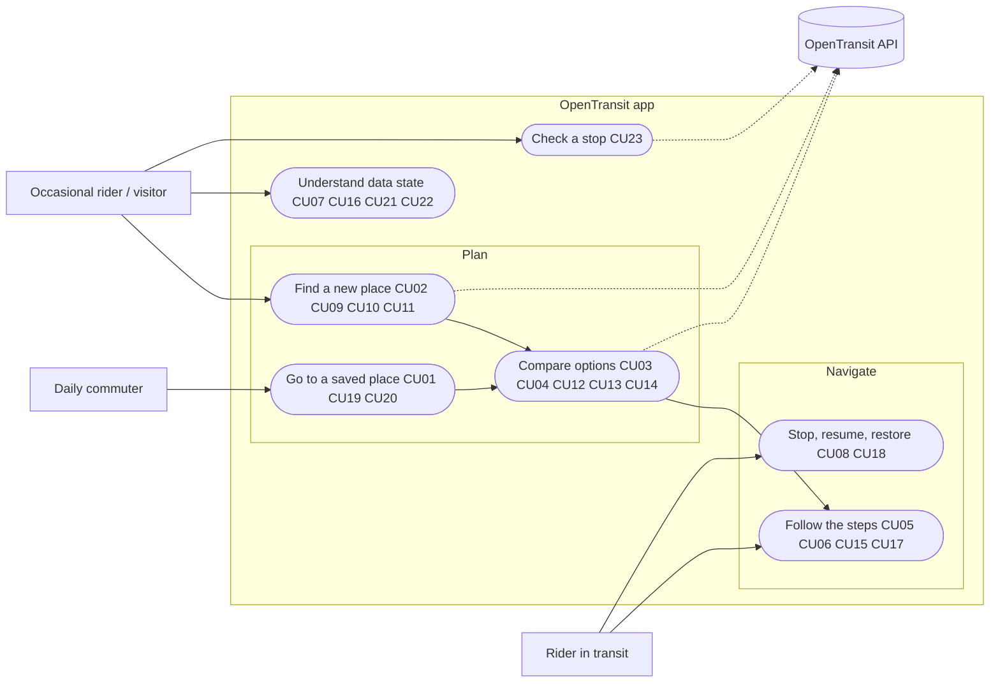

# OpenTransit client — Product Requirements

**Version:** 0.3 draft · **Date:** 3 October 2026 · **Status:** proposal, not accepted; nothing here is implemented. Version 0.3 adds stories CU10–CU23, the use-case view, and the changes the full design made necessary (marked "0.3").

This document says what the first product client must do and how we will know it does it. The [client design](client-design.md) says how it looks and how it is built, the [client execution plan](next-steps.md#phase-2-client-execution-plan) lists the tasks and what must be ready before coding, and the [dashboard](../PROJECT_STATUS.md) tracks progress. The [root PRD](../PRD.md) (§4, §15–§23) governs the overall product, and the [API PRD](api-prd.md) governs the API the client consumes. Implementation follows the October 1 gate revision: the client may start once M2–M4 are accepted locally and the private H-0/H-1 deployment begins. Public release still needs every Phase 1 acceptance item.

**Sequencing revision (user, 31 October 2026): web now, native later.** A Vite/React web client ([`apps/web`](../apps/web/README.md)) is built first, to a usable preview for the H-1 private deployment. The native app in the platform decision below follows after the API and deployment are stable, and shares the pure modules (API layer, `classify`, i18n, formatting, plan/nav logic). Requirements and phase gates are unchanged.

**Platform decision (user, 3 October 2026):** the client is a **native app for iPhone and Android**, built from one **Expo (React Native)** codebase, because an installed app opens faster, scrolls and responds with the system's own feel, and can keep navigating while the phone is locked. This replaces the design's earlier mobile-web plan; the API playground remains the browser tool. The Apple Developer Program fee ($99/year) is **not yet approved**, so iPhone builds wait for that decision (§10).

Requirements here are targets until a recorded measurement or human review shows they have been met.

## 1. Product outcome

A person in Israel opens the app, says where they are going, and is on their way with a trustworthy scheduled plan **faster and with less effort than with any other app**. Then the app tells them, one step at a time, what to do next until they arrive, even with the phone in their pocket.

The client does two jobs and nothing else:

1. **Plan** — choose where from and where to, and compare the options with every fact needed to choose.
2. **Navigate** — follow the chosen option: where to walk, which line, when it leaves, which platform, where to get off, and what comes next.

Everything else (stop boards, trip details, nearby stops, lines) is secondary and must never slow down or complicate those two jobs.

### Success and evidence

- **Speed:** every budget in §4 is met on both reference phones, recorded with dated measurements.
- **Simplicity:** a saved-place trip starts navigating in 2 taps; a new destination in typing plus 2 taps; a first-time user completes plan → navigate without help, as judged in the human review (§9).
- **Usable on real trips:** the user plans and follows real journeys on a phone and judges the client usable (HC review, §9).
- **Truthful:** every time is labelled scheduled; missing, stale or unavailable data never looks live or successful.

## 2. Principles, in priority order

When two principles conflict, the higher one wins. Speed and simplicity outrank everything except truthfulness, which is a constraint rather than a trade-off.

### 2.1 Speed is the product

Every interaction should feel instant. Speed means both **time on the clock** (open, response, render) and **effort** (taps, typing, reading, permission prompts). A feature that makes the common path slower is not added, however useful it is elsewhere.

- Nothing blocks the first screen: no splash beyond the system launch screen, no onboarding, sign-in or permission prompt.
- Home renders from what is already on the phone (favourites, recents, last origin); no network request is needed to show it.
- The map never blocks planning. From/To work before the map has loaded.
- Results appear as soon as both ends are known. There is no Plan button.
- The best option is preselected and its route shown; choosing is optional.
- Anything already fetched is reused: going back, reselecting an option or starting navigation makes no new request.
- Work the user is likely to need next (the best option's trip stop lists) is fetched while they are reading, never while they wait.
- Gestures (sheet, map, swipes) run on the UI thread and never wait for JavaScript.

### 2.2 Simple to use, simple to build

**For the passenger:**

- One surface: the map with one bottom sheet. No tab bars, menus, overflow buttons or modal dialogs on the core path.
- One obvious next action per screen, placed at the bottom of the sheet within thumb reach.
- Sensible defaults instead of choices: "now", my location as origin, the best option selected, three options.
- Plain Hebrew (gender-neutral plural imperative), short labels, no jargon (no "GTFS", "headsign", "generation").
- Settings are optional. The app is fully useful without ever opening them.

**For the code:**

- The client is a thin renderer over `/v1`. It holds no transport logic: no routing, ranking, timetable interpretation or ID mapping beyond what the API returns.
- One Expo codebase for both platforms. Platform-specific code only where the platform requires it (for example the iOS lock-screen step and the Android navigation notification). No backend-for-frontend, account system, analytics, crash-reporting or push service.
- A small, fixed dependency set (§5.2). Every additional dependency needs a stated reason and its size cost in the PR.
- Fewer screens, states and options beat configurable ones. If a setting exists only to resolve a design disagreement, pick one answer and remove the setting.

### 2.3 Truthful (constraint)

The client shows only what the API knows. Every time is scheduled and labelled as such. No route, no departures and no matches are honest empty results; unavailable or stale data is shown as unavailable or stale, never as an empty success or as live. Realtime and alerts remain deferred.

### 2.4 Private

No account, no analytics or tracking SDKs, no third-party fonts. Location is used on the phone only and never stored or sent to the server beyond the coordinates of a search or journey request. Favourites and recents stay on the phone.

### 2.5 Hebrew-first and accessible

Hebrew right-to-left first, English mirrored from it. WCAG 2.2 AA as applied to mobile apps, VoiceOver and TalkBack, and system text size. Every fact on the map is also available as text.

### Feature admission test

A proposed feature or control enters the core path only if **all** of these hold:

1. It serves planning or navigating a trip.
2. It adds no tap, field or prompt to the 2-tap saved-place path or the typing + 2-tap new-destination path.
3. It stays within every budget in §4, including app size.
4. It adds no top-level control (tab, menu, button outside the sheet) and no modal on the core path.
5. It needs no new transport logic in the client.

Otherwise it goes to a secondary screen, waits for a later phase, or is dropped. Record the decision in this document.

## 3. Users and jobs

| User | Job | What the client must make easy |
| --- | --- | --- |
| Daily commuter | Repeat a known trip (home ↔ work) | Two taps from opening the app to navigating; the answer already on screen |
| Occasional rider | Get to a new place | Find the place in Hebrew or English while typing; see at a glance which option is fastest, has fewer transfers, or walks less |
| Rider in transit | Not miss the stop or the connection | A glanceable step card, a buzz before the exit stop, and the current step on the lock screen |
| Visitor / English speaker | Same as above in English | Same flow, mirrored, with original Hebrew names where no translation exists |

The client does not serve operators, integrators or contributors; the API and its playground do.

## 4. Speed requirements

### 4.1 Reference conditions

- **Phones:** the user's iPhone (fast case) and a mid-range Android phone (about 2023, 4 GB RAM class; slow case). Both run release builds; development builds are not timed.
- **Network:** Israeli 4G against the deployed preview for field timings; for client-only timings, API responses are replayed from recorded fixtures at their measured p95.
- **Recording:** the app records performance marks and shows them in a hidden timing panel that can be copied out, so no Mac or cable is needed. Record the phone, OS version, network, place and date with each result.
- Timings are p95 over at least 20 runs unless stated otherwise. A single fast run is not evidence.

### 4.2 Budgets

| ID | Moment | Budget (iPhone / mid-range Android) | How measured |
| --- | --- | --- | --- |
| SP01 | Cold start (app not in memory) → From/To usable, Hebrew rendered | ≤ 1.0 s / ≤ 1.5 s | Mark from process start to first interactive Home frame |
| SP02 | Return from background → usable | ≤ 200 ms / ≤ 300 ms | Mark from app-state change to frame |
| SP03 | Saved place or recent tapped → visible feedback | ≤ 100 ms | Mark from touch to frame |
| SP04 | Both ends known → options chart and best option's route painted | ≤ 1.0 s field; client work after the response ≤ 100 ms / ≤ 150 ms | Marks around request and paint |
| SP05 | Pause in typing → updated suggestions | ≤ 400 ms field; client work after the response ≤ 50 ms | Marks; the debounce counts toward the budget |
| SP06 | Tap an option → its route details shown | ≤ 100 ms, no network | Mark from touch to frame |
| SP07 | Start navigation → step card shown | ≤ 100 ms, no network | Mark from touch to frame |
| SP08 | Position fix → step card distance/step updated, including with the screen locked | ≤ 1 s | Simulated route on the emulator; a real ride |
| SP09 | Earlier / Later → new options painted | ≤ 1.0 s field | Marks |
| SP10 | Sheet drag, map pan, swipe back | Display refresh rate (60 or 120 Hz) where practical; no JavaScript-thread stall > 100 ms during a gesture | Platform profiler trace |
| SP11 | App size | Download ≤ 30 MB per platform (estimate to verify after S0) | Store build report |
| SP12 | JavaScript bundle | Recorded after S0 as the baseline; CI fails on growth > 10% without a stated reason | Build report in CI |

The server side is already budgeted: journeys p95 < 350 ms at the API and < 400 ms from a deployed probe; search was accepted at 42.7 ms p95 (all requests). The field budgets above include network from Israel to the hosting Region, which H-0 must measure.

### 4.3 Required speed techniques

- Hermes engine and release builds; keep the system launch screen until the first Home frame, with nothing after it.
- Read favourites, recents and the last origin synchronously from on-device storage at start.
- Request the journey the moment both ends are known; cancel stale searches and journey requests.
- Keep the last journey response so Back, reselecting and navigation are instant, and persist the active trip.
- Fetch the best option's trips (for stop counts and the get-off cue) in the background after the chart paints.
- Initialise the map after Home is interactive; never delay From/To for it.
- Bottom sheet and gestures on the UI thread (Reanimated and Gesture Handler).
- No layout shift when results arrive: reserve space for the chart.

### 4.4 Speed regressions

CI fails on SP12. Client-only timings (SP01, SP04 client work, SP05 client work, SP06, SP07) are recorded on both phones at the end of each work slice from S4 on, and a regression above 20% from the recorded baseline blocks the slice. Field timings are recorded at H-1 and before public release.

## 5. Simplicity requirements

### 5.1 Experience

| ID | Requirement | Acceptance |
| --- | --- | --- |
| SI01 | Saved place or recent → navigating in 2 taps (place, Start); 3 if another option is chosen | Scripted end-to-end tap count |
| SI02 | New destination → navigating in typing + 2 taps (result, Start) | Scripted end-to-end tap count |
| SI03 | No permission prompt before the user asks for something that needs it. Location ("while using" only) is asked at "my location" or Start; the app never asks for "always" location. 0.3: notifications are asked at the first Start, because the locked-phone cue and the Android navigation notification need them; declining either leaves manual navigation working | Fresh-install test sees no prompt at launch |
| SI04 | No modal, menu, tab bar or overflow control on Home, Where to, Compare, Route details or Navigate | Component inventory check; design review |
| SI05 | Every core screen has exactly one primary action | Design review |
| SI06 | Swiping down, the Android back button or the iOS edge swipe returns one level and keeps the trip | End-to-end tests on both platforms |
| SI07 | Every core screen fits at 360 × 640 (Android) and on an iPhone SE-size screen: after an option is tapped, the chart and the start of its route are visible; while navigating, the step card and at least the next step | Screenshot checks |
| SI08 | First-time user completes plan → navigate without help | HC review (§9) |

### 5.2 Engineering

| ID | Requirement |
| --- | --- |
| SE01 | Dependencies are limited to the Expo SDK modules the app uses (location, task manager, haptics, keep-awake, localization, secure on-device storage), React Native, TanStack Query, zod, MapLibre React Native, Reanimated and Gesture Handler. 0.3 proposes two changes for the user to confirm (§10): the key-value store from `expo-sqlite` instead of the keychain-backed secure store (synchronous reads, no size limit, removed on uninstall), and local notifications (no push service) for the locked-phone cue. Adding one requires a stated reason and size cost in the PR; replacing one with less code is always welcome. |
| SE02 | No client-side transport logic: the client never reorders, filters or recomputes journeys, departures or times beyond formatting. |
| SE03 | One codebase, two store builds. The API base URL is set per build profile (local, preview, production); there is no web build of the client in this release. |
| SE04 | State lives in two places only: the TanStack Query cache, and versioned on-device storage for settings, favourites, at most 10 recents and the active trip. 0.3: transient screen state (the trip being planned, the selected option, text being typed) is ordinary component state, never persisted and not a third store. |
| SE05 | One problem-to-UI mapping (`classify(status, code)`) covers every error state; screens do not invent their own. |
| SE06 | Hebrew and English dictionaries have key parity, checked in CI. |
| SE07 | Everything except the final iPhone build and install can be developed and tested from Windows (Android emulator and phone; Expo cloud builds for iPhone). |

## 6. Functional requirements

Layouts, copy and interaction details are in the [client design](client-design.md#interface-direction-user-2-october-2026). MUST means required for the first usable release (H-1 preview); SHOULD means preferred, with any deviation recorded.

### C01 — Home

- MUST show From and To at once. From defaults to "my location" when location permission was already granted, otherwise the last origin; it never prompts on launch.
- MUST show Home, Work and favourite chips, then recents. Tapping one sets To and goes straight to Compare.
- MUST show a data-status banner only when data is stale, expired or a capability is unavailable; nothing when everything is normal.

### C02 — Where to (search)

- MUST search places, addresses, stops and stations in Hebrew and English as the user types (from 2 characters), cancelling outdated requests.
- MUST show the kind and locality of each result, and the real label language when no translation exists.
- MUST offer "choose on map" as a row, always.
- MUST show a partial or unavailable category inline instead of hiding it.
- SHOULD bias by location only when location permission is already granted.

### C03 — Compare

- MUST request journeys immediately when both ends are known, with "now" sent as an explicit time.
- MUST offer Now / Depart at / Arrive by inline, without a separate screen.
- MUST show up to three options on one shared time axis with duration, leave and arrive times, transfers and walking, and a rank label (recommended / fastest / fewest transfers).
- MUST preselect the best option, draw it on the map and show its route details.
- MUST offer Earlier and Later.
- MUST distinguish no route, outside the service window (showing coverage dates) and service unavailable.

### C04 — Route details

- MUST show, on tapping an option, every step without a further tap: walk distance and time (or time only when distance is unknown), line, operator or mode, headsign or train destination, platform, departure time, stop count, exit stop and transfer waits.
- 0.3: platform, stop count and stop names depend on two additive API changes (API-C1, API-C2 in the [design](client-design.md#contract-gaps-found-on-3-october-read-from-the-code-not-from-a-running-api)). Until the API supplies a fact the client omits it; it never guesses.
- MUST keep the chart in view while details are shown on the smallest supported screens (SI07).
- MUST pin "Start navigation" at the bottom of the sheet.

### C05 — Navigate

- MUST pin a high-contrast step card at the top of the sheet with the current instruction, countdown to departure, line, platform and exit stop.
- MUST show the whole trip as a checklist below the card (done, now, next) with the arrival time.
- MUST advance steps from on-device location, **including while the phone is locked or the app is in the background**, using "while using" permission only (iOS background location indicator; Android foreground-service notification). Location updates stop at Finish or when the trip is abandoned.
- MUST always offer a manual "next step"; without location permission, say so in one banner. 0.3: tapping a checklist row makes it the current step, so a wrong automatic advance can be corrected in either direction.
- 0.3: MUST keep the trip active when the user goes Back (Compare then offers "resume"); the trip ends at Finish, at "end trip", when another trip starts, or two hours after its scheduled arrival, and location updates stop with it.
- MUST NOT advance a step from the clock alone; without a position the card waits for a fix or a tap.
- MUST cue "get off in 2 stops" and "get off at the next stop" by haptics on both platforms, plus colour change and text.
- MUST show the current step outside the app: the Android navigation notification (required for background location anyway). SHOULD show it on the iPhone lock screen and Dynamic Island (Live Activity); this may follow the first preview.
- MUST keep the screen on while the navigate screen is visible, and restore the active trip after the app is killed and reopened.
- MUST make no server request during navigation except trips not yet fetched.

### C06 — Secondary screens (after the core flow)

Stop departures, trip details, nearby stops and lines, opened from names in the core flow. They follow the same principles and budgets but are not part of the first usable release's acceptance. They never add a control to the core screens beyond the tappable names.

### C07 — Settings

Language, Home and Work, favourites, clear all local data, attribution and data status. Reached from one icon on Home's sheet, not from the core path.

### Out of scope for this release

Accounts and sync, live times, vehicles and alerts (deferred until their sources pass), fares and payments, ticketing, push notifications, offline planning, a web version of the client, tablets and watches, ads, social features, trip history, accessibility routing (until source coverage is validated), multiple-stop trips and route preferences beyond depart/arrive time.

## 7. User stories

Each story is a release requirement, not a claim that it has passed.

| ID / story | Given → when → then | Boundary acceptance | Covers |
| --- | --- | --- | --- |
| CU01 Commuter: go home now | Home saved → open app, tap Home → options for now, best one shown with its route; tap Start → step card | 2 taps; SP01/SP03/SP04 budgets | C01, C03, C05, SI01 |
| CU02 Rider: get to a new address | Open app → type "אלנבי 30" → pick result → options shown | Street-level results labelled as street-level; SP05 budget | C02, C03, SI02 |
| CU03 Rider: arrive before an appointment | Destination chosen → Arrive by 09:00 → every option arrives by 09:00 | No option later than the deadline is shown | C03 |
| CU04 Rider: compare quickly | Three options → glance → see which is fastest, has fewest transfers, walks least | Readable on the smallest supported screens without scrolling; ranks in text, not colour alone | C03, SI07 |
| CU05 Rider: not miss the stop | Navigating on a bus with the phone locked in a pocket → two stops before the exit → buzz and "get off in 2 stops" | Manual advance works without location | C05 |
| CU06 Rider: make the connection | Transfer step → step card shows platform, countdown and the next line | Walk without a street path shows time only | C04, C05 |
| CU07 Rider: something is wrong | Data stale, service unavailable, outside the window, or no route → see which one it is and what to do | Never an empty success; retry where useful | C01, C03, §2.3 |
| CU08 Rider: app killed mid-trip | Navigating → system kills the app → reopen → same step restored | No network needed when trips were cached | C05 |
| CU09 English speaker | Language English → same flow mirrored left-to-right | Original Hebrew names where no translation exists | C02, §2.5 |
| CU10 Rider: pick a spot on the map | No good search result → "choose on map" → move the pin, confirm → options shown | The pin is sent as a coordinate; nothing is stored unless the trip is planned | C02, C03 |
| CU11 Rider: start from somewhere else | Tap From → search or swap → options from the new origin | "My location" is never saved as a recent or last origin | C01, C02 |
| CU12 Rider: leave later | Destination chosen → Depart at 17:30 → options leaving from 17:30 | A time that does not exist or occurs twice on a DST change is handled explicitly, never silently shifted | C03 |
| CU13 Rider: see earlier or later options | Options shown → Later → the next set replaces the chart | Each tap is one request; no option is invented or reordered by the client | C03, SP09, SE02 |
| CU14 Rider: choose a different option | Three options → tap the second → its route and details appear, the map redraws | No network; ≤ 100 ms (SP06) | C03, C04 |
| CU15 Rider: the app got the step wrong | Navigating → tap the right checklist row → it becomes the current step | Works without location; nothing is lost | C05 |
| CU16 New user: first launch | Fresh install → open → From/To usable at once, with "set Home" and "set Work" chips | No onboarding, sign-in or permission prompt (SI03) | C01 |
| CU17 Rider: location not allowed | Start with location denied → navigation runs with manual steps and one banner | Scheduled times still shown; no repeated prompts | C05, SI03 |
| CU18 Rider: stop or resume a trip | Navigating → Back → Compare offers "resume"; or "end trip" → Home, location stopped | No confirmation dialog; ending is one tap and resuming is one tap | C05, SI04, SI06 |
| CU19 Commuter: saved place after a timetable refresh | Home saved last week → tap Home → options shown as usual | An outdated place reference is retried with the saved coordinate without the user noticing | C03, §8 |
| CU20 Commuter: save Home, Work and favourites | Tap "set Home" → search → pick → the chip is ready | Saved on the phone only; rename and delete in Settings | C01, C07 |
| CU21 Privacy-minded rider: erase everything | Settings → clear all local data → saved places, recents and the active trip are gone | Uninstalling removes the same data | C07, §2.4 |
| CU22 Rider using a screen reader or large text | VoiceOver/TalkBack or the largest text size → plan and navigate the same trip | Options are read as a list with rank, duration and transfers; step and cue changes are announced | §2.5, §8 |
| CU23 Rider: check a stop (secondary) | Tap a stop name in the route → its scheduled departures | An empty board is a valid result; unavailable is shown as unavailable | C06 |

### Use-case view

### Story coverage

| Screen | Stories | Built in |
| --- | --- | --- |
| Home | CU01, CU07, CU16, CU20 | S4 |
| Where to / from | CU02, CU09, CU10, CU11 | S4 |
| Compare and route details | CU01–CU04, CU06, CU07, CU12–CU14, CU19 | S5 |
| Navigate | CU05, CU06, CU08, CU15, CU17, CU18 | S6 |
| Settings | CU20, CU21 | S4 |
| Secondary | CU23 | S7 |
| All core screens | CU09, CU22 | S4–S6 |

## 8. Truthfulness, privacy and accessibility

These follow the [client design](client-design.md#cross-cutting-rules) and are release requirements:

- Times are Asia/Jerusalem with a "scheduled" label. Capability comes from `meta.capabilities` and `/v1/status` only; unavailable live data reads "Live times and alerts unavailable".
- Every API problem maps to one UI state through `classify()`: coverage dates, place-ref retry with the saved coordinate, list restart, "no longer in the timetable", `Retry-After`, "temporarily unavailable", "can't reach OpenTransit".
- No analytics, tracking or crash-reporting SDKs. Location is never stored; background location runs only during an active navigation. Store privacy labels state "no data collected" beyond request contents needed to answer them.
- Accessibility: VoiceOver and TalkBack labels on every control, system text size up to the largest standard setting without clipping on core screens, 44 pt targets, announcements when the step changes, nothing conveyed by colour alone.

## 9. Acceptance and release

| Gate | Done when |
| --- | --- |
| Mechanical | Every core-path budget (SP01–SP12) and simplicity check (SI01–SI07, SE01–SE07) passes in CI or a dated device record; accessibility checks pass on core screens in both languages on both platforms; the real Dizengoff Center → Technion journey plans and replays through navigation against the local API. |
| Field | SP01, SP04, SP05, SP08 and SP09 measured on both reference phones against the H-1 preview, with phone, OS, network and date recorded. |
| HC — human review | The user plans and follows at least 5 real trips on a phone (including at least one train, one transfer, one arrive-by and one with the phone locked), plus one first-time user completes plan → navigate unaided. Each trip gets a usable / not usable verdict with notes. Passes at 4 of 5 usable and the first-time run unaided. Structural or automated checks never substitute for this verdict. |
| Public release | HC passed, field budgets met, App Store and Google Play review passed, plus every Phase 1 acceptance item and the static release gate in the [root PRD](../PRD.md). |

## 10. Open decisions for the user

1. **Apple Developer Program ($99/year):** not yet approved (3 October). Without it, development and testing use the Android emulator and an Android phone from Windows; the iOS simulator needs a Mac, and Expo Go cannot run the map or background location. Enrolment (by the user; no credentials pass through agents) is needed before any iPhone build, at the latest for the S6 navigation slice and HC.
2. **Reference Android phone:** which mid-range Android do we measure on (borrowed or bought)? And which iPhone model and iOS version is yours? Without both, field budgets cannot be recorded.
3. **Preview access for the app:** the H-1 preview admits only a reviewer IP range, which a phone on 4G will not match. Choose another way to keep it private (for example a per-build access token checked at the load balancer or API) before field tests.
4. **Hosting Region:** the AWS project is in `eu-north-1`; serving Israel from Stockholm adds network time to every request (SP04, SP05, SP09). H-0 should measure it before the Region is fixed.
5. **Google Play developer account ($25 one-time):** not needed for testing (builds install directly on Android) but needed for Play distribution before public release.
6. **HC review size:** are 5 personal trips plus one first-time user enough, or should HC require more people?
7. **Start before H-0?** The dashboard gates the client on the start of the private H-0/H-1 deployment, which waits for the H-0 approval. Slices S0–S6 need only the local API and recorded fixtures. Either revise the gate so they can start now (S8 and field timings still wait for the preview), or keep the gate.
8. **API additions for the client (0.3):** approve API-C1 (stop name, coordinates and platform on each trip call) and API-C2 (platform on journey legs). Both are additive; without them route details and the get-off cue are incomplete.
9. **Local notifications (0.3):** allow a notification permission prompt at the first Start, so the get-off cue reaches a locked phone (iPhone cannot vibrate from the background otherwise; Android 13+ hides the navigation notification without it). No push service is involved.
10. **Storage module (0.3):** the `expo-sqlite` key-value store instead of the secure store named in SE01.
11. **Appearance (0.3):** light only for the first preview, or light and dark following the system? Dark doubles the visual checks; the design system must define both.
12. **App identifiers (0.3):** the Android package and iOS bundle ID (for example `org.opentransit.app`) are permanent once published; choose them before S0, with the display name.
13. **Defaults pending from the design:** the name "OpenTransit", system fonts, OpenFreeMap tiles for the preview (the tile host sees IPs and viewports) moving to self-hosted tiles before public release.
